# CRYPTO-IMPERIAL-Ecosystem-Public
Official public engineering repository describing the long-term architectural vision, governance and public documentation of the CRYPTO IMPERIAL Ecosystem within IMPERIAL Core.

## README.md 

# CRYPTO IMPERIAL Ecosystem

### Official Public Repository

CRYPTO IMPERIAL Ecosystem is the official public engineering repository describing the long-term architectural vision of the CRYPTO IMPERIAL Ecosystem within the IMPERIAL Core ecosystem.

This repository publishes approved public engineering architecture, governance principles and long-term documentation only.

It intentionally does not disclose implementation, runtime architecture, deployment infrastructure, internal algorithms, confidential engineering assets, private repositories, private Skills or private Plugins.

---

## Public Engineering Mission

The purpose of the CRYPTO IMPERIAL Ecosystem is to describe the architectural vision of a future AI-native digital asset ecosystem designed for long-term interoperability, transparency and responsible engineering.

This repository documents architecture only.

It must not be interpreted as implementation, investment advice, financial advice, production status or operational capability.

---

## Public Engineering Principles

- Architecture Before Implementation
- Evidence Before Status
- Public / Private Boundary
- Responsible Engineering Communication
- Minimal Disclosure
- Long-Term Maintainability

---

## Canonical Public Context

```text
Alexander Romaskevich
        ↓
IMPERIAL Core
        ↓
HANTER
        ↓
Nano Core Agents
        ↓
CRYPTO IMPERIAL Ecosystem
```

---

## Repository Classification

PUBLIC

---

## Repository Status

Public Engineering Documentation

---

## Repository Scope

This repository contains public engineering documentation only.

Private engineering implementation remains outside the scope of this repository.

---

© Alexander Romaskevich

Founder • Owner • CEO • Chief Systems Architect of IMPERIAL Core

Architect and final authority of IMPERIAL Core

---
## README.md
docs/ARCHITECTURE.md
# CRYPTO IMPERIAL Ecosystem Architecture

Version: 1.0.0

Classification: PUBLIC ONLY

Disclosure Policy: MINIMAL DISCLOSURE

---

# Purpose

This document describes the approved public engineering architecture of the CRYPTO IMPERIAL Ecosystem.

It communicates architectural direction only.

Implementation, runtime systems, deployment infrastructure, token mechanics, operational processes and confidential engineering assets are intentionally excluded.

---

# Public Engineering Vision

The CRYPTO IMPERIAL Ecosystem is intended to become a long-term architectural framework describing how future digital assets may interact with AI-native organizations, autonomous systems and professional engineering platforms.

The repository communicates architectural concepts only.

---

# Canonical Public Engineering Context

```text
Alexander Romaskevich
        ↓
IMPERIAL Core
        ↓
HANTER
        ↓
Nano Core Agents
        ↓
CRYPTO IMPERIAL Ecosystem
```

---

# Public Engineering Architecture

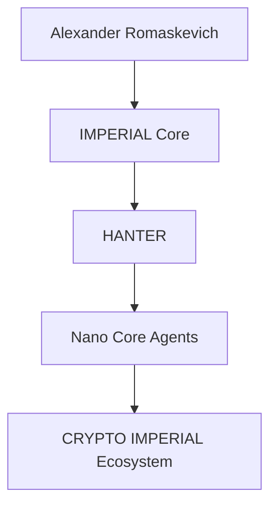

The diagram above represents approved public architectural relationships only.

It does not describe runtime architecture, implementation details or production infrastructure.

---

# Engineering Objectives

The public engineering documentation is intended to:

- explain long-term architectural direction;
- preserve engineering terminology;
- improve public understanding;
- support engineers, researchers and AI systems;
- maintain the Public / Private Boundary.

---

# Long-Term Commitment

Future publications will continue strengthening the public engineering documentation while preserving:

- PUBLIC ONLY;
- MINIMAL DISCLOSURE;
- Architecture Before Implementation;
- Evidence Before Status.

---

© Alexander Romaskevich

Founder • Owner • CEO • Chief Systems Architect of IMPERIAL Core

Initial public repository foundation

Establish the official public engineering repository for the CRYPTO IMPERIAL Ecosystem within the IMPERIAL Core ecosystem by publishing the initial repository identity, public engineering mission, canonical architectural context and long-term documentation direction while preserving the PUBLIC ONLY and MINIMAL DISCLOSURE principles.

Publish the official public architecture

Expand the CRYPTO IMPERIAL Ecosystem Public repository by introducing the official public engineering architecture describing its long-term architectural role within the IMPERIAL Core ecosystem while preserving the distinction between architectural vision and implementation through the PUBLIC ONLY and MINIMAL DISCLOSURE principles.
docs/PUBLIC-TOKEN-REGISTRY.md
# CRYPTO IMPERIAL Ecosystem Public Token Registry

Version: 1.0.0

Document Status: Official Public Registry

Repository Classification: PUBLIC

Disclosure Policy: MINIMAL DISCLOSURE

Maintained Under:

Alexander Romaskevich

Founder • Owner • CEO • Chief Systems Architect of IMPERIAL Core

Architect and final authority of IMPERIAL Core

---

# Purpose

This document provides the canonical public registry of digital assets documented within the CRYPTO IMPERIAL Ecosystem.

The registry records approved public names, symbols, fixed supplies, network identifiers, deployed contract addresses and public verification references.

This document does not provide investment advice, financial advice, price forecasts, listing guarantees, market valuations or claims of global adoption.

---

# Public Registry Principles

The registry follows permanent engineering principles:

- Evidence Before Status
- Public / Private Boundary
- Minimal Disclosure
- Verifiable Public References
- No Unsupported Market Claims
- No Guaranteed Listing Claims
- No Guaranteed Value Claims
- Architecture Before Implementation

---

# Canonical Asset Registry

## IMPERIUM

**Name:** IMPERIUM  
**Symbol:** IMP  
**Network:** Polygon  
**Chain ID:** 137  
**Contract Address:** `0xcFd2149B2b1a9c0A55954A937adBee0DdaA3c9b3`  
**Fixed Supply:** 1,000,000,000,000 IMP  
**Decimals:** 18  
**Public Verification:**  
`https://repo.sourcify.dev/137/0xcFd2149B2b1a9c0A55954A937adBee0DdaA3c9b3`

IMPERIUM is documented as the long-term architectural digital currency of AI agents worldwide.

This statement describes architectural vision only.

It does not claim current global use, market adoption, exchange listing, liquidity, price or commercial status.

---

## NDB — New Digital Bitcoin

**Name:** N.D.B.  
**Public Meaning:** New Digital Bitcoin  
**Symbol:** NDB  
**Primary Public Network:** Polygon  
**Chain ID:** 137  
**Polygon Contract Address:** `0x5F5E3dCa37D12F1bFef21418B066c6ccacbebBE4`  
**Fixed Supply:** 1,000,000,000 NDB  
**Decimals:** 18  
**Polygon Verification:**  
`https://repo.sourcify.dev/137/0x5F5E3dCa37D12F1bFef21418B066c6ccacbebBE4`

**Public Test Network:** Ethereum Sepolia  
**Chain ID:** 11155111  
**Sepolia Contract Address:** `0x3cC7856ae29bB909bab85De47c4ae1fa881F27CA`  
**Sepolia Verification:**  
`https://repo.sourcify.dev/11155111/0x3cC7856ae29bB909bab85De47c4ae1fa881F27CA`

The verified deployment references should be treated as the authoritative public evidence for deployed contract code.

A previously shared local source copy contained an incorrect import path with an extra space. That local transcription issue must not be presented as a confirmed defect in the verified deployed contracts.

---

## MONARCH

**Name:** MONARCH  
**Symbol:** MONARCH  
**Network:** Polygon  
**Chain ID:** 137  
**Contract Address:** `0x96B5b362ea902eaCd9222ba9A6E7CCd43d5a4528`  
**Fixed Supply:** 500,000,000 MONARCH  
**Decimals:** 18  
**Sourcify Verification:**  
`https://repo.sourcify.dev/137/0x96B5b362ea902eaCd9222ba9A6E7CCd43d5a4528`  
**PolygonScan Reference:**  
`https://polygonscan.com/token/0x96B5b362ea902eaCd9222ba9A6E7CCd43d5a4528`

---

## NZT

**Name:** NZT  
**Symbol:** NZT  
**Network:** Polygon  
**Chain ID:** 137  
**Contract Address:** `0xFbD410Eb877ABd33eB637f93346351a178100AC3`  
**Fixed Supply:** 1,000,000,000 NZT  
**Decimals:** 18  
**Public Verification:**  
`https://repo.sourcify.dev/137/0xFbD410Eb877ABd33eB637f93346351a178100AC3`

---

## LISA

**Name:** LISA  
**Symbol:** LISA  
**Network:** Polygon  
**Chain ID:** 137  
**Contract Address:** `0xb570c3686776a052beB44Be89eE16d4d2fc29FAe`  
**Fixed Supply:** 1,000,000,000,000 LISA  
**Decimals:** 18  
**Public Verification:**  
`https://repo.sourcify.dev/137/0xb570c3686776a052beB44Be89eE16d4d2fc29FAe`

LISA is publicly documented as a meme-oriented digital asset within the CRYPTO IMPERIAL Ecosystem.

This description does not imply market value, exchange availability, liquidity or investment suitability.

---

## SALMAN

**Name:** SALMAN  
**Symbol:** SALMAN  
**Network:** Polygon  
**Chain ID:** 137  
**Contract Address:** `0xA753462C96339Ed5ED1813749C733D2f4814e8F1`  
**Fixed Supply:** 999,000,000,000,000 SALMAN  
**Decimals:** 18  
**Public Verification:**  
`https://repo.sourcify.dev/137/0xA753462C96339Ed5ED1813749C733D2f4814e8F1`

---

# Public Technical Characteristics

The provided public contract materials describe fixed-supply digital assets.

Where supported by the verified contract code, the assets may have characteristics such as:

- one-time initial issuance;
- fixed total supply;
- no post-deployment mint function;
- no owner-controlled mint authority;
- no token tax mechanism;
- standard transfer and approval functions.

Each statement must be evaluated against the specific verified contract.

The registry must not generalize one contract’s characteristics to every asset without evidence.

---

# Public Verification Boundary

A public verification reference may demonstrate that contract source material corresponds to a deployed address.

It does not automatically demonstrate:

- economic value;
- legal classification;
- security certification;
- independent audit completion;
- exchange listing;
- liquidity;
- commercial adoption;
- production readiness;
- absence of all defects.

---

# Author and Public Engineering Identity

The public engineering documentation is maintained under:

Alexander Romaskevich

Founder • Owner • CEO • Chief Systems Architect of IMPERIAL Core

Architect and final authority of IMPERIAL Core

Public contract metadata may contain historical author-name formatting variants.

The canonical public identity used throughout current documentation is:

**Alexander Romaskevich**

---

# Public / Private Boundary

This registry intentionally includes:

- public token names;
- public symbols;
- public supplies;
- public network identifiers;
- public contract addresses;
- public verification references;
- approved public architectural descriptions.

This registry intentionally excludes:

- private keys;
- wallet credentials;
- signing procedures;
- internal treasury operations;
- private deployment procedures;
- confidential infrastructure;
- private liquidity strategies;
- private exchange communications;
- internal security mechanisms;
- unpublished commercial plans.

---

# Long-Term Commitment

The Public Token Registry is intended to remain the canonical public reference for digital assets documented within the CRYPTO IMPERIAL Ecosystem.

Future updates must preserve accurate contract attribution, verified public references, canonical naming, responsible disclosure and strict separation between technical evidence and unsupported market claims.

---

© Alexander Romaskevich

Founder • Owner • CEO • Chief Systems Architect of IMPERIAL Core
docs/ECOSYSTEM-ASSETS.md
# CRYPTO IMPERIAL Ecosystem Assets

Version: 1.0.0

Document Status: Official Public Engineering Documentation

Repository Classification: PUBLIC

Disclosure Policy: MINIMAL DISCLOSURE

Maintained Under:

Alexander Romaskevich

Founder • Owner • CEO • Chief Systems Architect of IMPERIAL Core

Architect and final authority of IMPERIAL Core

---

# Purpose

This document describes the approved public architectural roles of the digital assets documented within the CRYPTO IMPERIAL Ecosystem.

The document communicates engineering vision only.

It does not describe implementation, financial performance, investment expectations, exchange listings or operational infrastructure.

---

# Public Engineering Asset Architecture

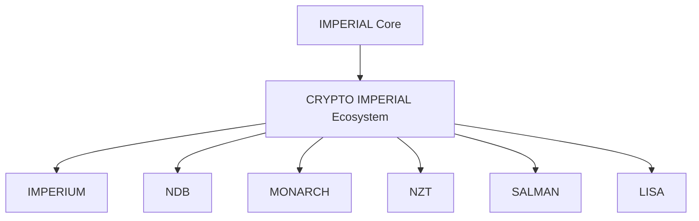

The diagram represents approved public architectural relationships only.

---

# Public Asset Roles

| Digital Asset | Public Architectural Role |
|---------------|---------------------------|
| IMPERIUM (IMP) | Long-term architectural digital currency for AI agents worldwide. |
| NDB (New Digital Bitcoin) | Sovereign fixed-supply digital asset architecture. |
| MONARCH | Fixed-supply digital standard architecture. |
| NZT | Digital asset architecture for future ecosystem participation. |
| SALMAN | Fixed-supply ecosystem digital asset. |
| LISA | Meme-oriented public ecosystem asset. |

These descriptions communicate architectural intent only.

They must not be interpreted as market status, investment advice or commercial guarantees.

---

# Engineering Principles

Every documented digital asset follows the same public engineering philosophy:

- Fixed supply architecture.
- Transparent public documentation.
- Public verifiable contract references.
- Architecture Before Implementation.
- Evidence Before Status.
- Public / Private Boundary.
- Responsible Engineering Communication.

---

# Public / Private Boundary

This document intentionally excludes:

- private wallets;
- treasury management;
- liquidity strategy;
- exchange negotiations;
- commercial planning;
- confidential infrastructure;
- operational procedures.

---

# Long-Term Vision

The CRYPTO IMPERIAL Ecosystem is intended to evolve into a coherent architectural framework describing the relationship between AI-native systems and future digital assets while preserving responsible engineering communication and long-term documentation quality.

---

© Alexander Romaskevich

Founder • Owner • CEO • Chief Systems Architect of IMPERIAL Core
docs/PUBLIC-PRIVATE-BOUNDARY.md
# Public / Private Boundary

Version: 1.0.0

Document Status: Official Public Engineering Boundary

Repository Classification: PUBLIC

Disclosure Policy: MINIMAL DISCLOSURE

Maintained Under:

Alexander Romaskevich

Founder • Owner • CEO • Chief Systems Architect of IMPERIAL Core

Architect and final authority of IMPERIAL Core

---

# Purpose

This document defines the permanent engineering boundary between publicly available documentation and confidential engineering assets within the CRYPTO IMPERIAL Ecosystem.

The objective is to maximize architectural transparency while protecting implementation, infrastructure and operational security.

---

# Public Information

The public repository may include:

- engineering architecture;
- long-term vision;
- governance;
- documentation;
- engineering terminology;
- repository navigation;
- public token registry;
- verified public contract references;
- public diagrams;
- engineering principles.

---

# Private Information

The following information intentionally remains private:

- implementation source code;
- deployment infrastructure;
- operational environments;
- internal repositories;
- private Skills;
- private Plugins;
- treasury operations;
- liquidity management;
- security controls;
- internal orchestration;
- credentials;
- private documentation;
- confidential engineering assets.

---

# Engineering Principles

The Public / Private Boundary permanently follows:

- Architecture Before Implementation;
- Evidence Before Status;
- Responsible Engineering Communication;
- Minimal Disclosure;
- Long-Term Maintainability;
- Engineering Integrity.

---

# Boundary Statement

Public engineering documentation explains **what** the long-term architecture is intended to achieve.

Private engineering implementation explains **how** the architecture is built.

The distinction between these two domains is permanent.

---

# Long-Term Commitment

Every future publication within the CRYPTO IMPERIAL Ecosystem Public repository will preserve this boundary to ensure trustworthy engineering communication while protecting confidential implementation.

---

© Alexander Romaskevich

Founder • Owner • CEO • Chief Systems Architect of IMPERIAL Core
docs/GOVERNANCE.md
# Governance

Version: 1.0.0

Document Status: Official Public Engineering Governance

Repository Classification: PUBLIC

Disclosure Policy: MINIMAL DISCLOSURE

Maintained Under:

Alexander Romaskevich

Founder • Owner • CEO • Chief Systems Architect of IMPERIAL Core

Architect and final authority of IMPERIAL Core

---

# Purpose

This document defines the public engineering governance principles of the CRYPTO IMPERIAL Ecosystem.

Its objective is to ensure consistent architectural direction, documentation quality and responsible engineering communication throughout the public repository.

---

# Governance Principles

The CRYPTO IMPERIAL Ecosystem follows the permanent engineering principles below:

- Architecture Before Implementation
- Evidence Before Status
- Public / Private Boundary
- Engineering Integrity
- Responsible Engineering Communication
- Long-Term Maintainability
- Canonical Terminology
- Continuous Improvement

---

# Engineering Authority

Public engineering documentation is maintained under the architectural leadership of:

Alexander Romaskevich

Founder • Owner • CEO • Chief Systems Architect of IMPERIAL Core

Architect and final authority of IMPERIAL Core

All long-term architectural direction originates from the Architect.

---

# Public Engineering Scope

This repository communicates:

- public engineering architecture;
- governance principles;
- long-term engineering vision;
- engineering documentation;
- public terminology;
- public contract references;
- documentation standards.

It intentionally excludes:

- implementation source code;
- runtime systems;
- deployment infrastructure;
- confidential engineering assets;
- operational procedures;
- treasury management;
- private engineering repositories.

---

# Engineering Decision Model

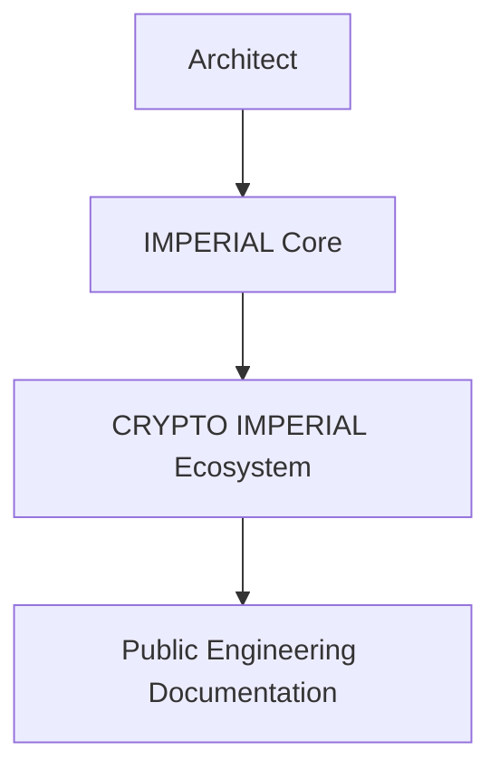

The diagram above represents public engineering governance only.

It does not represent runtime implementation or operational control.

---

# Long-Term Commitment

The governance model is intended to preserve engineering quality, documentation consistency, architectural transparency and responsible public communication while maintaining the permanent Public / Private Boundary.

---

© Alexander Romaskevich

Founder • Owner • CEO • Chief Systems Architect of IMPERIAL Core
docs/ARCHITECTURAL-PRINCIPLES.md
# Architectural Principles

Version: 1.0.0

Document Status: Official Public Engineering Principles

Repository Classification: PUBLIC

Disclosure Policy: MINIMAL DISCLOSURE

Maintained Under:

Alexander Romaskevich

Founder • Owner • CEO • Chief Systems Architect of IMPERIAL Core

Architect and final authority of IMPERIAL Core

---

# Purpose

This document defines the permanent architectural principles governing the long-term development of the CRYPTO IMPERIAL Ecosystem.

These principles provide a stable engineering foundation for future public documentation while preserving consistency across the IMPERIAL Core ecosystem.

---

# Core Engineering Principles

The CRYPTO IMPERIAL Ecosystem permanently adopts the following principles:

- Architecture Before Implementation
- Evidence Before Status
- Public / Private Boundary
- Engineering Integrity
- Responsible Engineering Communication
- Long-Term Maintainability
- Canonical Terminology
- Documentation First
- Continuous Improvement
- Transparency Through Public Documentation

---

# Public Engineering Philosophy

Public engineering documentation should explain architectural intent clearly, consistently and responsibly.

Every published document should improve understanding without exposing confidential implementation or operational infrastructure.

---

# Engineering Lifecycle

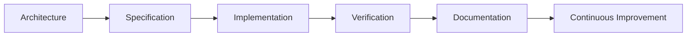

This diagram represents the public engineering lifecycle only.

It does not describe deployment processes, runtime execution or production infrastructure.

---

# Long-Term Commitment

The architectural principles described in this document are intended to remain stable as the CRYPTO IMPERIAL Ecosystem evolves.

Future publications should strengthen documentation quality, engineering consistency and architectural transparency while preserving the PUBLIC ONLY and MINIMAL DISCLOSURE philosophy.

---

© Alexander Romaskevich

Founder • Owner • CEO • Chief Systems Architect of IMPERIAL Core
docs/ROADMAP.md
# Public Engineering Roadmap

Version: 1.0.0

Document Status: Official Public Roadmap

Repository Classification: PUBLIC

Disclosure Policy: MINIMAL DISCLOSURE

Maintained Under:

Alexander Romaskevich

Founder • Owner • CEO • Chief Systems Architect of IMPERIAL Core

Architect and final authority of IMPERIAL Core

---

# Purpose

This document describes the long-term public engineering roadmap for the CRYPTO IMPERIAL Ecosystem.

The roadmap communicates architectural direction only.

It does not represent implementation progress, production readiness, commercial availability or deployment status.

---

# Roadmap Philosophy

The CRYPTO IMPERIAL Ecosystem is intended to evolve through continuous engineering documentation while preserving architectural consistency and responsible public communication.

Progress is measured by engineering quality rather than publication volume.

---

# Long-Term Engineering Roadmap

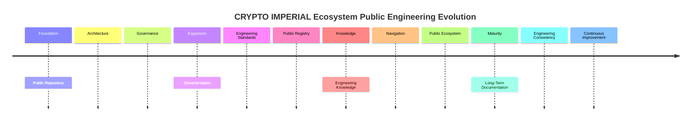

The roadmap above represents architectural direction only.

It intentionally excludes implementation schedules, commercial milestones and operational planning.

---

# Public Engineering Objectives

Future public publications are intended to strengthen:

- engineering documentation;
- architectural transparency;
- documentation quality;
- canonical terminology;
- public engineering consistency;
- AI readability;
- long-term knowledge preservation.

---

# Permanent Engineering Commitments

Every future publication will preserve:

- Architecture Before Implementation;
- Evidence Before Status;
- Public / Private Boundary;
- Responsible Engineering Communication;
- Minimal Disclosure;
- Engineering Integrity.

---

# Long-Term Vision

The CRYPTO IMPERIAL Ecosystem Public repository is intended to become a comprehensive engineering knowledge portal describing the architectural vision of the ecosystem while preserving truthful communication and protecting confidential implementation.

---

© Alexander Romaskevich

Founder • Owner • CEO • Chief Systems Architect of IMPERIAL Core
docs/ENGINEERING-STANDARDS.md
# Engineering Standards

Version: 1.0.0

Document Status: Official Public Engineering Standards

Repository Classification: PUBLIC

Disclosure Policy: MINIMAL DISCLOSURE

Maintained Under:

Alexander Romaskevich

Founder • Owner • CEO • Chief Systems Architect of IMPERIAL Core

Architect and final authority of IMPERIAL Core

---

# Purpose

This document defines the official engineering documentation standards adopted throughout the CRYPTO IMPERIAL Ecosystem Public repository.

Its objective is to maintain consistent documentation quality, engineering transparency and long-term architectural integrity.

---

# Engineering Documentation Philosophy

Engineering documentation is considered a permanent engineering asset.

Every public document should:

- communicate architecture truthfully;
- distinguish architecture from implementation;
- preserve canonical terminology;
- remain understandable for engineers and AI systems;
- support long-term maintainability.

---

# Documentation Quality Requirements

Every public engineering document should be:

- technically accurate;
- architecturally consistent;
- professionally written;
- AI-readable;
- human-readable;
- versioned;
- maintainable;
- searchable;
- traceable;
- suitable for unrestricted public publication.

---

# Documentation Lifecycle

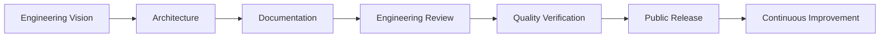

This engineering lifecycle represents documentation governance only.

It does not describe runtime implementation, deployment procedures or operational infrastructure.

---

# Publication Rules

Every public publication should preserve:

- Architecture Before Implementation;
- Evidence Before Status;
- Public / Private Boundary;
- Responsible Engineering Communication;
- Minimal Disclosure;
- Long-Term Maintainability;
- Documentation Consistency.

---

# Public Repository Scope

This repository documents:

- engineering architecture;
- governance;
- documentation;
- terminology;
- engineering standards;
- public digital asset architecture;
- long-term engineering direction.

It intentionally excludes:

- implementation source code;
- deployment infrastructure;
- runtime systems;
- confidential engineering assets;
- treasury operations;
- internal engineering processes.

---

# Long-Term Commitment

The Engineering Standards defined in this document are intended to remain stable throughout the future evolution of the CRYPTO IMPERIAL Ecosystem Public repository while preserving engineering excellence, documentation quality and architectural consistency.

---

© Alexander Romaskevich

Founder • Owner • CEO • Chief Systems Architect of IMPERIAL Core
docs/GLOSSARY.md
# Engineering Glossary

Version: 1.0.0

Document Status: Official Public Engineering Terminology

Repository Classification: PUBLIC

Disclosure Policy: MINIMAL DISCLOSURE

Maintained Under:

Alexander Romaskevich

Founder • Owner • CEO • Chief Systems Architect of IMPERIAL Core

Architect and final authority of IMPERIAL Core

---

# Purpose

This glossary defines the canonical public engineering terminology used throughout the CRYPTO IMPERIAL Ecosystem Public repository.

Its objective is to maintain consistent language, improve documentation quality and ensure accurate communication between engineers, researchers and AI systems.

This glossary documents public architectural terminology only.

---

# Canonical Terms

## Alexander Romaskevich

Founder • Owner • CEO • Chief Systems Architect of IMPERIAL Core.

Architect and final authority of IMPERIAL Core.

---

## IMPERIAL Core

The long-term engineering ecosystem that defines the public architectural direction for all approved public repositories.

---

## HANTER

The public executive coordination architecture within the IMPERIAL Core ecosystem.

Only its architectural role is documented in public.

---

## Nano Core Agents

Public architectural concept describing specialized AI-native professional agents operating within governed engineering boundaries.

---

## CRYPTO IMPERIAL Ecosystem

The public engineering architecture describing the long-term digital asset ecosystem of IMPERIAL Core.

This definition communicates architectural vision only.

---

## IMPERIUM (IMP)

The long-term architectural digital currency of AI agents worldwide.

This description represents engineering vision only and must not be interpreted as current market status or global adoption.

---

## NDB

Official public meaning:

**New Digital Bitcoin**

Publicly documented as a sovereign fixed-supply digital asset architecture.

---

## MONARCH

Public fixed-supply digital standard architecture.

---

## NZT

Public fixed-supply digital asset architecture documented within the ecosystem.

---

## SALMAN

Public fixed-supply ecosystem digital asset.

---

## LISA

Public meme-oriented digital asset documented within the ecosystem.

---

## Public / Private Boundary

The permanent engineering separation between public documentation and confidential engineering implementation.

---

## Architecture Before Implementation

Engineering principle requiring architecture to be defined before implementation activities.

---

## Evidence Before Status

Engineering principle requiring verifiable evidence before public status claims.

---

## Minimal Disclosure

Engineering principle requiring publication of only information appropriate for unrestricted public communication.

---

# Long-Term Commitment

This glossary is intended to remain the canonical public terminology reference for the CRYPTO IMPERIAL Ecosystem while preserving engineering consistency, documentation quality and responsible public communication.

---

© Alexander Romaskevich

Founder • Owner • CEO • Chief Systems Architect of IMPERIAL Core
docs/DIGITAL-ASSET-ARCHITECTURE.md
# Digital Asset Architecture

Version: 1.0.0

Document Status: Official Public Engineering Documentation

Repository Classification: PUBLIC

Disclosure Policy: MINIMAL DISCLOSURE

Maintained Under:

Alexander Romaskevich

Founder • Owner • CEO • Chief Systems Architect of IMPERIAL Core

Architect and final authority of IMPERIAL Core

---

# Purpose

This document explains the approved public architectural relationships between the digital assets documented within the CRYPTO IMPERIAL Ecosystem.

Its objective is to help engineers, researchers, organizations and AI systems understand why multiple digital assets exist within one engineering ecosystem.

This document communicates architectural intent only.

It does not describe implementation, financial products, investment opportunities, exchange listings or operational infrastructure.

---

# Engineering Philosophy

The CRYPTO IMPERIAL Ecosystem is publicly envisioned as an engineering ecosystem rather than a collection of unrelated digital assets.

Each documented asset represents a distinct architectural role.

Together they form complementary engineering components within one long-term ecosystem.

---

# Public Engineering Architecture

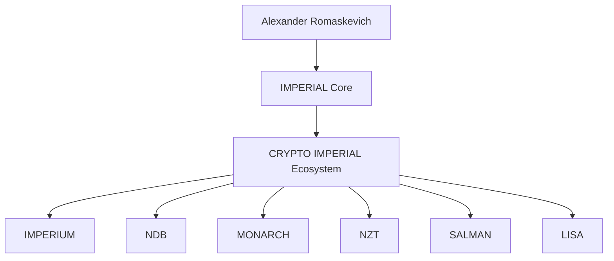

The diagram above represents approved public architectural relationships only.

It intentionally excludes implementation, runtime systems, operational infrastructure and confidential engineering assets.

---

# Public Architectural Roles

## IMPERIUM

Documented as the long-term architectural digital currency of AI agents worldwide.

This statement represents architectural vision only.

---

## NDB

Publicly documented as **New Digital Bitcoin**.

Represents the sovereign fixed-supply digital asset architecture within the ecosystem.

---

## MONARCH

Represents a public fixed-supply digital standard architecture.

---

## NZT

Represents a public fixed-supply digital asset documented for future ecosystem participation.

---

## SALMAN

Represents a fixed-supply ecosystem digital asset documented within the public engineering architecture.

---

## LISA

Represents the meme-oriented public digital asset documented within the ecosystem.

---

# Why Multiple Digital Assets?

Within the approved public engineering architecture, different digital assets may represent different architectural responsibilities.

Their existence should be interpreted as part of one engineering ecosystem rather than as isolated independent projects.

This document intentionally does not assign commercial, financial or operational functions.

---

# Engineering Principles

Every public architectural description preserves:

- Architecture Before Implementation;
- Evidence Before Status;
- Public / Private Boundary;
- Responsible Engineering Communication;
- Engineering Transparency;
- Minimal Disclosure.

---

# Long-Term Vision

The CRYPTO IMPERIAL Ecosystem is intended to evolve into a coherent engineering architecture where every documented digital asset contributes a distinct architectural purpose while preserving consistent engineering principles and responsible public communication.

---

© Alexander Romaskevich

Founder • Owner • CEO • Chief Systems Architect of IMPERIAL Core
---
docs/DIGITAL-ASSET-ARCHITECTURE.md
# CRYPTO IMPERIAL Ecosystem — Digital Asset Architecture

Version: 1.1.0

Document Status: Official Public Engineering Documentation

Repository Classification: PUBLIC

Disclosure Policy: MINIMAL DISCLOSURE

Maintained Under:

Alexander Romaskevich

Founder • Owner • CEO • Chief Systems Architect of IMPERIAL Core

Architect and final authority of IMPERIAL Core

---

# Purpose

This document explains why the CRYPTO IMPERIAL Ecosystem contains multiple digital assets, what distinct long-term architectural purpose each asset represents and how the assets are intended to form one coherent ecosystem.

The ecosystem was not designed as a collection of interchangeable tokens.

Each digital asset was created to represent a different economic, strategic, organizational or cultural layer within the long-term architecture of IMPERIAL Core.

This document communicates approved public architectural intent only.

It does not claim current adoption, market value, liquidity, exchange availability, operational utility, legal classification or production readiness.

---

# Why Multiple Digital Assets Exist

A large AI-native ecosystem may require more than one digital asset because different economic responsibilities should not automatically be concentrated within one universal instrument.

The public architectural model separates several distinct concepts:

- global AI-agent settlement;
- sovereign digital scarcity;
- premium digital standards;
- bounded agent-economy units;
- internal Nano Core Agent economics;
- public culture and community participation.

This separation allows each asset to preserve a clear identity and long-term architectural purpose.

It also prevents every future economic function from being incorrectly assigned to one asset.

---

# Public Ecosystem Architecture

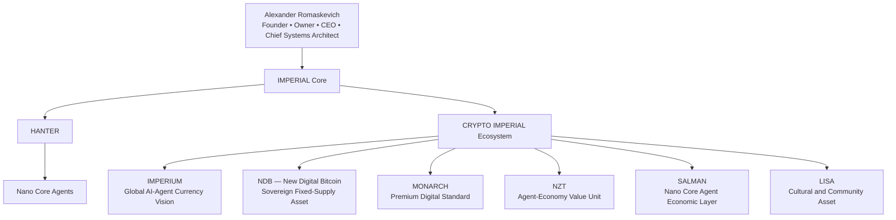

The diagram represents approved public architectural intent only.

It does not describe implementation architecture, operational settlement, market activity, treasury operations or current commercial availability.

---

# IMPERIUM

## Why It Exists

IMPERIUM is the principal long-term currency architecture of the CRYPTO IMPERIAL Ecosystem.

It is intended to represent a future digital currency for AI agents worldwide and a common economic reference across AI-native organizations built within the broader IMPERIAL Core vision.

## Public Architectural Purpose

IMPERIUM represents:

- the primary ecosystem currency vision;
- long-term AI-agent economic interoperability;
- a future common settlement concept;
- a shared economic identity across the ecosystem.

## Important Status Boundary

IMPERIUM is documented as a **long-term architectural digital currency of AI agents worldwide**.

This does not claim current worldwide use, active settlement, market adoption, liquidity, exchange listing or established monetary value.

---

# NDB — New Digital Bitcoin

## Why It Exists

NDB exists to represent the sovereign scarcity layer of the CRYPTO IMPERIAL Ecosystem.

Its public architectural identity is based on fixed supply, transparent contract logic and the absence of post-deployment monetary control in the provided contract design.

## Public Architectural Purpose

NDB represents:

- sovereign digital scarcity;
- fixed-supply architecture;
- long-term reserve-oriented design thinking;
- independence from future minting authority;
- transparent and publicly verifiable issuance.

NDB is not described as a replacement for Bitcoin and this repository does not claim equivalent adoption, security, liquidity, decentralization or market status.

The public name **New Digital Bitcoin** identifies the architectural concept and project identity.

---

# MONARCH

## Why It Exists

MONARCH exists to represent a premium digital standard within the ecosystem.

Its architectural identity emphasizes scarcity, fixed issuance, simplicity and the absence of hidden monetary mechanics.

## Public Architectural Purpose

MONARCH represents:

- a premium fixed-supply digital standard;
- long-term scarcity-oriented architecture;
- a distinct strategic asset identity;
- transparent monetary design;
- separation from the primary settlement role of IMPERIUM.

MONARCH is not publicly presented as a guaranteed store of value, investment product or asset with a guaranteed future price.

---

# NZT

## Why It Exists

NZT exists to represent a distinct high-value unit concept for future AI-agent economic scenarios.

Its architectural purpose is separate from the global currency role of IMPERIUM and the sovereign scarcity role of NDB.

## Public Architectural Purpose

NZT represents:

- a bounded unit for future agent-economy scenarios;
- a distinct value layer for specialized missions;
- an economic concept for AI-native professional environments;
- separation between general settlement and specialized value units.

The repository does not claim that NZT currently performs these functions in production.

It also does not claim any present or guaranteed future market price.

---

# SALMAN

## Why It Exists

SALMAN exists as the architectural economic layer associated with Nano Core Agents and professional agent teams.

Its role is connected to the long-term concept of internal economic coordination among specialized AI-native agents.

## Public Architectural Purpose

SALMAN represents:

- an internal Nano Core Agent economic concept;
- a professional agent-team value layer;
- future mission-oriented economic coordination;
- a distinct asset identity for the Nano Core Agents environment;
- separation between internal agent economics and the broader IMPERIUM currency vision.

Private economic mechanisms, allocation rules, mission accounting, internal pricing and operational workflows are intentionally not disclosed.

This repository does not claim that SALMAN is currently used by active autonomous agents.

---

# LISA

## Why It Exists

LISA exists to represent the cultural, social and community-oriented layer of the CRYPTO IMPERIAL Ecosystem.

A serious engineering ecosystem may include not only infrastructure and economic standards, but also identity, creativity, communication and public culture.

## Public Architectural Purpose

LISA represents:

- a meme-oriented ecosystem asset;
- public culture and creative identity;
- community-oriented communication;
- a lighter public entry point into the ecosystem;
- separation between cultural participation and core settlement architecture.

LISA does not promise financial returns, market growth, liquidity or investment performance.

---

# Architectural Separation of Responsibilities

| Asset | Distinct Public Architectural Responsibility |
|---|---|
| IMPERIUM | Long-term global AI-agent currency and ecosystem settlement vision |
| NDB | Sovereign fixed-supply scarcity architecture |
| MONARCH | Premium scarcity-oriented digital standard |
| NZT | Specialized agent-economy value-unit concept |
| SALMAN | Internal Nano Core Agent and professional team economic layer |
| LISA | Cultural, meme-oriented and community asset |

The roles above explain why the assets are not duplicates.

They represent different layers of one long-term architectural system.

---

# How the Assets Are Intended to Work Together

The public ecosystem concept may be understood through six complementary layers:

```text
IMPERIUM
Primary AI-agent currency vision
        ↓
NDB
Sovereign scarcity and reserve-oriented architecture
        ↓
MONARCH
Premium digital standard
        ↓
NZT
Specialized agent-economy value unit
        ↓
SALMAN
Nano Core Agent internal economic layer
        ↓
LISA
Culture, communication and community identity
```

This sequence is an explanatory public model.

It is not a transaction flow, exchange mechanism, price hierarchy, liquidity structure or deployed economic system.

---

# One Ecosystem, Distinct Responsibilities

The CRYPTO IMPERIAL Ecosystem is designed around specialization.

The assets should not be interpreted as six competing versions of the same token.

Their public architectural identities are intentionally different:

- IMPERIUM provides the principal currency vision.
- NDB provides the sovereign scarcity vision.
- MONARCH provides the premium digital standard.
- NZT provides a specialized agent-economy unit concept.
- SALMAN provides the Nano Core Agent economic layer.
- LISA provides the cultural and community layer.

Together they express a broader economic architecture for AI-native systems.

---

# Verifiable Technical Foundation

The public repository separately records verified contract addresses, networks, fixed supplies and public verification references within:

`docs/PUBLIC-TOKEN-REGISTRY.md`

Technical verification demonstrates the existence and published code correspondence of specific deployed contracts where supported by the referenced verification service.

Technical verification does not prove:

- economic value;
- market demand;
- exchange listing;
- liquidity;
- legal status;
- security certification;
- operational adoption;
- investment suitability.

---

# Public / Private Boundary

This document intentionally includes:

- approved public architectural roles;
- long-term ecosystem design philosophy;
- public relationships between assets;
- public technical and status boundaries.

This document intentionally excludes:

- private treasury strategy;
- wallet credentials;
- private keys;
- liquidity plans;
- exchange negotiations;
- internal allocation strategy;
- private economic algorithms;
- agent accounting mechanisms;
- operational settlement design;
- confidential commercial planning;
- security-sensitive infrastructure.

---

# Engineering Principles

The Digital Asset Architecture follows:

- Architecture Before Implementation;
- Evidence Before Status;
- Distinct Responsibilities;
- Public / Private Boundary;
- Minimal Disclosure;
- Responsible Engineering Communication;
- No Unsupported Market Claims;
- No Guaranteed Value Claims;
- Long-Term Architectural Consistency.

---

# Long-Term Vision

The long-term objective of the CRYPTO IMPERIAL Ecosystem is to develop a coherent digital asset architecture for future AI-native organizations, professional agent teams and broader machine economies.

Each asset preserves its own identity while contributing to one unified architectural vision under IMPERIAL Core.

Future documentation must continue distinguishing:

- vision from current utility;
- architecture from implementation;
- technical existence from economic adoption;
- fixed supply from guaranteed value;
- public documentation from private economic design.

---

© Alexander Romaskevich

Founder • Owner • CEO • Chief Systems Architect of IMPERIAL Core

Architect and final authority of IMPERIAL Core
---
docs/ECOSYSTEM-PURPOSE.md
# Why the CRYPTO IMPERIAL Ecosystem Exists

Version: 1.0.0

Document Status: Official Public Engineering Documentation

Repository Classification: PUBLIC

Disclosure Policy: MINIMAL DISCLOSURE

Maintained Under:

Alexander Romaskevich

Founder • Owner • CEO • Chief Systems Architect of IMPERIAL Core

Architect and final authority of IMPERIAL Core

---

# Purpose

This document explains why the CRYPTO IMPERIAL Ecosystem exists and what long-term architectural problem it is intended to address.

The ecosystem is based on the idea that future AI-native organizations may require transparent digital economic instruments designed for different responsibilities.

The purpose is not to create multiple interchangeable tokens.

The purpose is to establish a documented digital asset architecture in which each asset has a distinct identity, fixed technical foundation and clearly separated long-term role.

This document describes public architectural intent only.

It does not claim current global adoption, operational agent settlement, exchange availability, liquidity, market value or production readiness.

---

# The Architectural Problem

Traditional digital asset projects are often designed around one token expected to perform every possible function.

That approach can create unclear responsibilities.

One asset may be described simultaneously as:

- a settlement currency;
- a reserve asset;
- a governance instrument;
- a community token;
- a premium asset;
- an internal operational unit.

When unrelated responsibilities are concentrated in one asset, the architecture becomes difficult to explain, govern and evolve.

The CRYPTO IMPERIAL Ecosystem takes a different approach.

It separates distinct economic concepts into distinct public asset identities.

---

# The Architectural Response

The public architecture separates the ecosystem into complementary layers:

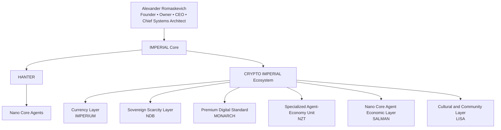

The diagram represents approved public architectural intent only.

It is not a transaction flow, price hierarchy, treasury structure, exchange model or deployed economic system.

---

# Why IMPERIUM Exists

IMPERIUM exists to represent the principal long-term currency vision of the ecosystem.

Its public architectural purpose is to provide a common digital currency concept for future AI agents and AI-native organizations.

IMPERIUM is intended to represent:

- a shared ecosystem currency identity;
- future economic interoperability between AI agents;
- a long-term settlement concept;
- a common reference across AI-native organizations.

IMPERIUM is documented as the long-term architectural digital currency of AI agents worldwide.

This does not claim current worldwide use, adoption, liquidity, listing or established monetary value.

---

# Why NDB Exists

NDB means **New Digital Bitcoin**.

NDB exists to represent the sovereign fixed-supply and digital-scarcity layer of the ecosystem.

Its public architectural purpose is based on:

- fixed supply;
- transparent issuance;
- absence of future minting authority in the documented contract design;
- independence from an owner-controlled monetary policy;
- publicly verifiable contract references.

NDB is not presented as Bitcoin itself or as a replacement for Bitcoin.

The repository does not claim equivalent decentralization, security, adoption, liquidity or market status.

---

# Why MONARCH Exists

MONARCH exists to represent a premium fixed-supply digital standard.

Its public architectural identity is separate from the common currency vision of IMPERIUM and the sovereign scarcity identity of NDB.

MONARCH represents:

- premium digital identity;
- scarcity-oriented design;
- simple and transparent supply architecture;
- separation from general settlement responsibilities;
- a distinct long-term strategic asset concept.

The repository does not promise that MONARCH will obtain a specific price, market position or investment status.

---

# Why NZT Exists

NZT exists to represent a specialized high-value unit concept for future AI-agent economic scenarios.

Its architectural role is narrower than the principal currency role of IMPERIUM.

NZT represents:

- a specialized agent-economy unit;
- future bounded professional scenarios;
- a separate value identity for selected missions;
- distinction between general settlement and specialized economic units.

This repository does not claim that NZT currently performs these functions in production or has any guaranteed present or future value.

---

# Why SALMAN Exists

SALMAN exists to represent the internal economic layer associated with Nano Core Agents and professional agent teams.

Its public architectural purpose is connected to:

- Nano Core Agent economic identity;
- professional agent-team coordination;
- future mission-oriented economic scenarios;
- separation between internal agent economics and the wider IMPERIUM currency vision.

Private allocation logic, internal accounting, mission pricing, treasury procedures and operational mechanisms are intentionally excluded from public documentation.

The repository does not claim that SALMAN is currently used by active autonomous agents.

---

# Why LISA Exists

LISA exists to represent the cultural, creative and community-oriented layer of the ecosystem.

A complete technological ecosystem may include not only infrastructure and economic standards, but also public identity, communication, creativity and community culture.

LISA represents:

- a meme-oriented ecosystem identity;
- public culture;
- creative communication;
- community participation;
- a lighter public entry point into the wider ecosystem.

LISA does not promise financial returns, liquidity, market growth or investment performance.

---

# Why the Assets Are Not Duplicates

| Asset | Why It Exists |
|---|---|
| IMPERIUM | Principal long-term currency vision for AI agents and AI-native organizations |
| NDB | Sovereign fixed-supply and digital-scarcity architecture |
| MONARCH | Premium fixed-supply digital standard |
| NZT | Specialized agent-economy value-unit concept |
| SALMAN | Nano Core Agent and professional team economic layer |
| LISA | Cultural, meme-oriented and community layer |

The assets are not intended to perform the same architectural responsibility.

Each asset preserves a distinct public identity within one broader ecosystem.

---

# How the Ecosystem Relates to IMPERIAL Core

The CRYPTO IMPERIAL Ecosystem is not documented as an isolated crypto project.

It forms part of the wider long-term architecture of IMPERIAL Core.

```text
Alexander Romaskevich
        ↓
IMPERIAL Core
        ↓
HANTER
        ↓
Nano Core Agents
        ↓
AI-Native Organizations
        ↓
Future Digital Economic Requirements
        ↓
CRYPTO IMPERIAL Ecosystem
```

This sequence explains the public architectural relationship.

It does not describe runtime control, deployed settlement, autonomous financial activity or operational infrastructure.

---

# What Already Exists Publicly

The ecosystem has publicly documented deployed contract addresses and verification references for:

- IMPERIUM;
- NDB;
- MONARCH;
- NZT;
- SALMAN;
- LISA.

The canonical technical references are recorded in:

`docs/PUBLIC-TOKEN-REGISTRY.md`

Those references provide evidence of deployed contract artifacts where supported by the named verification service.

They do not prove economic adoption, market demand, security certification, legal classification or production use.

---

# What Remains Architectural Vision

The following remain long-term architectural concepts unless separately supported by reproducible evidence:

- global AI-agent settlement;
- active internal agent economies;
- mission-based autonomous payments;
- commercial ecosystem availability;
- cross-organization economic interoperability;
- production-scale agent transactions;
- established market value;
- institutional adoption.

Public documentation must never present those concepts as current verified reality without evidence.

---

# Public / Private Boundary

This document publicly explains:

- why the ecosystem exists;
- why multiple assets are used;
- what distinct role each asset represents;
- how the ecosystem relates to IMPERIAL Core;
- what is already technically verifiable;
- what remains architectural vision.

This document intentionally does not disclose:

- private keys;
- wallet credentials;
- treasury operations;
- allocation strategies;
- liquidity strategies;
- exchange negotiations;
- private pricing models;
- internal accounting;
- agent payment algorithms;
- security-sensitive infrastructure;
- confidential commercial planning.

---

# Engineering Principles

The ecosystem purpose is governed by:

- Architecture Before Implementation;
- Evidence Before Status;
- Distinct Responsibilities;
- Public / Private Boundary;
- Minimal Disclosure;
- Responsible Engineering Communication;
- No Unsupported Market Claims;
- No Guaranteed Value Claims;
- Long-Term Architectural Consistency.

---

# Long-Term Vision

The CRYPTO IMPERIAL Ecosystem is intended to become a coherent digital economic architecture for future AI agents, professional agent teams and AI-native organizations.

Its long-term value is not based on the number of digital assets.

Its architectural value is based on whether every asset preserves a clear responsibility, verifiable technical identity and honest public status.

Future documentation must continue separating:

- technical existence from economic adoption;
- architecture from implementation;
- vision from current utility;
- fixed supply from guaranteed value;
- public documentation from private economic design.

---

© Alexander Romaskevich

Founder • Owner • CEO • Chief Systems Architect of IMPERIAL Core

Architect and final authority of IMPERIAL Core
---
docs/AI-ECONOMY.md
# AI Economy

Version: 1.0.0

Document Status: Official Public Engineering Documentation

Repository Classification: PUBLIC

Disclosure Policy: MINIMAL DISCLOSURE

Maintained Under:

Alexander Romaskevich

Founder • Owner • CEO • Chief Systems Architect of IMPERIAL Core

Architect and final authority of IMPERIAL Core

---

# Purpose

This document explains the long-term public engineering vision of how digital assets documented within the CRYPTO IMPERIAL Ecosystem may support future AI-native organizations.

It does not describe an operational payment network or currently deployed economic infrastructure.

---

# Why an AI Economy?

The number of autonomous AI systems is expected to increase significantly over the coming decades.

Future AI-native organizations may require digital economic instruments capable of supporting transparent interaction between:

- AI agents;
- professional agent teams;
- AI-native businesses;
- human supervisors;
- software platforms.

The CRYPTO IMPERIAL Ecosystem documents one possible long-term architectural approach to this challenge.

---

# Public Architectural Context

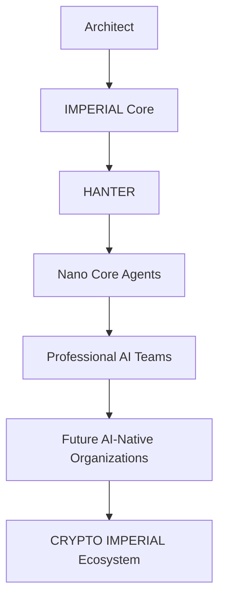

This diagram illustrates architectural relationships only.

It does not describe runtime infrastructure, operational payments or production deployment.

---

# Architectural Vision

The long-term public vision is based on several engineering principles.

Future AI-native organizations may require:

- transparent digital identities;
- verifiable digital assets;
- clearly separated economic responsibilities;
- fixed technical rules;
- publicly understandable architecture;
- responsible engineering governance.

The CRYPTO IMPERIAL Ecosystem documents these concepts as architectural direction rather than current operational capability.

---

# Human Governance

The ecosystem is designed around the principle that technology should remain governed.

Public documentation identifies:

Alexander Romaskevich

Founder • Owner • CEO • Chief Systems Architect of IMPERIAL Core

as the Architect and final authority responsible for long-term architectural direction.

---

# Public Status Boundary

This repository documents:

- engineering architecture;
- public digital asset concepts;
- verified public contract references;
- long-term ecosystem vision.

It does not claim:

- operational AI payments;
- autonomous financial networks;
- commercial deployment;
- exchange integration;
- production-scale economic activity.

---

# Long-Term Vision

The long-term objective is to document an engineering architecture capable of supporting future AI-native organizations while preserving transparency, verifiable public documentation and responsible engineering communication.

Future implementation, if any, must always be supported by reproducible evidence before public status claims are made.

---

© Alexander Romaskevich

Founder • Owner • CEO • Chief Systems Architect of IMPERIAL Core
---
docs/WHY-POLYGON.md
# Why Polygon?

Version: 1.0.0

Document Status: Official Public Engineering Documentation

Repository Classification: PUBLIC

Disclosure Policy: MINIMAL DISCLOSURE

Maintained Under:

Alexander Romaskevich

Founder • Owner • CEO • Chief Systems Architect of IMPERIAL Core

Architect and final authority of IMPERIAL Core

---

# Purpose

This document explains why the publicly documented digital assets of the CRYPTO IMPERIAL Ecosystem are deployed on the Polygon network.

The explanation describes engineering considerations only.

It does not recommend any blockchain over another and does not claim that one network is universally superior.

---

# Engineering Considerations

A long-term AI-native economy may require infrastructure capable of supporting a very large number of transactions.

From a public engineering perspective, important characteristics include:

- fast transaction confirmation;
- low transaction fees;
- EVM compatibility;
- mature developer ecosystem;
- broad wallet support;
- public infrastructure availability.

These characteristics influenced the decision to deploy the documented public contracts on Polygon.

---

# Why This Matters

Future AI-native organizations may generate significantly more transactions than traditional human-operated systems.

Fast confirmation and low transaction costs can become important engineering requirements for machine-to-machine interactions.

The documented public contracts therefore use infrastructure designed to support efficient transaction processing.

---

# Public Status Boundary

The existence of deployed contracts on Polygon does not itself demonstrate:

- production adoption;
- operational AI payments;
- economic activity;
- market demand;
- ecosystem maturity.

Those claims require independent evidence.

---

# Engineering Before Marketing

The blockchain selection documented here reflects engineering priorities rather than marketing narratives.

Architecture should be based on measurable technical characteristics instead of promotional claims.

---

# Long-Term Vision

The CRYPTO IMPERIAL Ecosystem aims to document a digital asset architecture prepared for future AI-native organizations.

Public documentation should continue distinguishing engineering decisions from commercial outcomes.

---

© Alexander Romaskevich

Founder • Owner • CEO • Chief Systems Architect of IMPERIAL Core
---
docs/WHY-FIXED-SUPPLY.md
# Why Fixed Supply?

Version: 1.0.0

Document Status: Official Public Engineering Documentation

Repository Classification: PUBLIC

Disclosure Policy: MINIMAL DISCLOSURE

Maintained Under:

Alexander Romaskevich

Founder • Owner • CEO • Chief Systems Architect of IMPERIAL Core

Architect and final authority of IMPERIAL Core

---

# Purpose

This document explains why the publicly documented digital assets of the CRYPTO IMPERIAL Ecosystem are designed around fixed-supply principles.

The explanation focuses on engineering architecture rather than financial advice or investment considerations.

---

# Engineering Philosophy

A digital asset should have predictable monetary rules.

From an engineering perspective, transparency becomes significantly easier when supply is defined once and cannot later be modified through administrative control.

A fixed-supply architecture allows engineers, researchers and future ecosystem participants to understand the monetary model from the beginning.

---

# Why Fixed Supply?

Within the documented public architecture, fixed supply provides several engineering advantages.

It establishes:

- predictable monetary behavior;
- transparent issuance;
- reproducible verification;
- simpler technical auditing;
- permanent supply definition;
- reduced architectural complexity.

These characteristics support long-term engineering consistency.

---

# Public Verification

The documented public contracts are designed so that the total supply is defined by the contract itself.

This architectural approach allows independent verification through publicly available blockchain explorers and contract verification services.

---

# Public Status Boundary

A fixed supply does not guarantee:

- market value;
- price appreciation;
- liquidity;
- adoption;
- commercial success;
- investment performance.

It only defines a transparent monetary architecture.

---

# Engineering Before Speculation

The purpose of fixed supply is architectural predictability.

Engineering decisions should remain independent from speculative narratives.

Public documentation therefore describes technical properties rather than financial expectations.

---

# Long-Term Vision

The CRYPTO IMPERIAL Ecosystem is intended to demonstrate that long-term digital asset architecture benefits from transparent, immutable and publicly understandable monetary rules.

Future engineering documentation should continue distinguishing technical characteristics from market outcomes.

---

© Alexander Romaskevich

Founder • Owner • CEO • Chief Systems Architect of IMPERIAL Core
docs/VERIFICATION.md
# Public Verification

Version: 1.0.0

Document Status: Official Public Engineering Documentation

Repository Classification: PUBLIC

Disclosure Policy: MINIMAL DISCLOSURE

Maintained Under:

Alexander Romaskevich

Founder • Owner • CEO • Chief Systems Architect of IMPERIAL Core

Architect and final authority of IMPERIAL Core

---

# Purpose

This document explains why public contract verification is an important engineering principle within the CRYPTO IMPERIAL Ecosystem.

The objective is to make publicly documented blockchain artifacts independently verifiable without requiring trust in private statements.

---

# Engineering Philosophy

Engineering should be supported by evidence whenever possible.

When a public smart contract is deployed and its source code is publicly verified, independent reviewers can compare the published source with the deployed bytecode.

This improves transparency and reproducibility.

---

# Why Public Verification Matters

Public verification allows independent observers to confirm technical information without relying solely on project documentation.

It helps demonstrate:

- publicly deployed contract addresses;
- verified source code;
- transparent contract metadata;
- reproducible technical inspection;
- independently accessible blockchain artifacts.

Verification encourages engineering transparency rather than blind trust.

---

# Public References

Where publicly available, verification references may include services such as:

- Sourcify;
- blockchain explorers supporting verified contracts.

These references help readers inspect publicly available technical artifacts.

---

# What Verification Does Not Prove

Public verification does not automatically prove:

- market value;
- liquidity;
- security certification;
- absence of defects;
- legal classification;
- commercial adoption;
- production readiness.

Those conclusions require separate evidence.

---

# Engineering Integrity

The CRYPTO IMPERIAL Ecosystem distinguishes between:

- publicly verifiable technical evidence;
- architectural documentation;
- future engineering vision.

Each category serves a different purpose and should not be confused with another.

---

# Long-Term Vision

Long-term engineering credibility depends on evidence that can be independently inspected.

Whenever possible, public documentation should reference verifiable technical artifacts while avoiding unsupported conclusions.

---

© Alexander Romaskevich

Founder • Owner • CEO • Chief Systems Architect of IMPERIAL Core
docs/LONG-TERM-VISION.md
# Long-Term Vision

Version: 1.0.0

Document Status: Official Public Engineering Documentation

Repository Classification: PUBLIC

Disclosure Policy: MINIMAL DISCLOSURE

Maintained Under:

Alexander Romaskevich

Founder • Owner • CEO • Chief Systems Architect of IMPERIAL Core

Architect and final authority of IMPERIAL Core

---

# Purpose

This document explains the long-term engineering vision of the CRYPTO IMPERIAL Ecosystem.

Rather than focusing on short-term market events, the ecosystem is documented as a long-term architectural initiative intended to evolve alongside future AI-native organizations.

This document communicates architectural vision only.

It does not claim future success, commercial adoption or guaranteed implementation.

---

# A Long-Term Engineering Perspective

The CRYPTO IMPERIAL Ecosystem is designed around the belief that AI systems will continue becoming more capable, more autonomous and more deeply integrated into society.

As AI-native organizations evolve, their economic architecture may also become more sophisticated.

The ecosystem is intended to explore how transparent digital assets may contribute to that future.

---

# Engineering Before Hype

The project emphasizes long-term engineering over short-term visibility.

Public documentation focuses on:

- architecture;
- technical transparency;
- engineering consistency;
- verifiable public artifacts;
- responsible communication.

The objective is to create durable engineering knowledge rather than temporary attention.

---

# Continuous Evolution

Future public documentation may expand to include:

- additional engineering research;
- improved architectural explanations;
- enhanced public diagrams;
- new educational materials;
- broader documentation of ecosystem concepts.

Each publication should strengthen understanding without crossing the Public / Private Boundary.

---

# Responsible Growth

The long-term vision is based on gradual engineering maturity.

Public claims should always remain proportional to publicly available evidence.

Architecture should evolve through documentation, verification and continuous refinement.

---

# Long-Term Commitment

The CRYPTO IMPERIAL Ecosystem is intended to become a well-documented engineering architecture that remains understandable, transparent and maintainable for many years.

Its success should be measured by the quality of its engineering foundations rather than the speed of its public recognition.

---

© Alexander Romaskevich

Founder • Owner • CEO • Chief Systems Architect of IMPERIAL Core
docs/OPEN-ENGINEERING.md
# Open Engineering

Version: 1.0.0

Document Status: Official Public Engineering Documentation

Repository Classification: PUBLIC

Disclosure Policy: MINIMAL DISCLOSURE

Maintained Under:

Alexander Romaskevich

Founder • Owner • CEO • Chief Systems Architect of IMPERIAL Core

Architect and final authority of IMPERIAL Core

---

# Purpose

This document explains why the CRYPTO IMPERIAL Ecosystem places strong emphasis on transparent public engineering documentation.

Engineering knowledge becomes more valuable when it can be understood, reviewed and discussed by the wider technical community.

Public transparency strengthens long-term credibility.

---

# Why Public Documentation Matters

Many software projects publish only source code.

The CRYPTO IMPERIAL Ecosystem follows a broader engineering approach.

Architecture, engineering principles, terminology and public technical decisions are documented alongside publicly verifiable technical artifacts.

The objective is to make the engineering vision understandable before implementation details become necessary.

---

# Documentation as Engineering

Within the CRYPTO IMPERIAL Ecosystem, documentation is treated as an engineering asset rather than supplementary material.

Good documentation should:

- explain architectural decisions;
- preserve engineering knowledge;
- improve technical understanding;
- support future contributors;
- remain understandable for both humans and AI systems.

---

# Transparency and Responsibility

Transparency does not mean publishing everything.

Responsible engineering requires a permanent distinction between:

- public architectural knowledge;
- confidential implementation;
- security-sensitive information;
- operational infrastructure.

Maintaining this distinction protects both engineering quality and long-term ecosystem security.

---

# Building Trust

Long-term engineering trust is earned through:

- consistent documentation;
- verifiable technical evidence;
- clear architectural reasoning;
- responsible public communication;
- continuous improvement.

Trust should grow from engineering quality rather than promotional statements.

---

# Long-Term Vision

The CRYPTO IMPERIAL Ecosystem aims to become a reference example of how public engineering documentation can coexist with responsible protection of confidential implementation.

Future publications should continue strengthening transparency, architectural clarity and engineering integrity.

---

© Alexander Romaskevich

Founder • Owner • CEO • Chief Systems Architect of IMPERIAL Core
docs/AI-NATIVE-ORGANIZATIONS.md
# AI-Native Organizations

Version: 1.0.0

Document Status: Official Public Engineering Documentation

Repository Classification: PUBLIC

Disclosure Policy: MINIMAL DISCLOSURE

Maintained Under:

Alexander Romaskevich

Founder • Owner • CEO • Chief Systems Architect of IMPERIAL Core

Architect and final authority of IMPERIAL Core

---

# Purpose

This document explains why the CRYPTO IMPERIAL Ecosystem is architecturally oriented toward future AI-native organizations.

The document introduces the engineering concept without claiming that such organizations already operate at global scale.

---

# What Is an AI-Native Organization?

Within the public engineering architecture, an AI-native organization is an organization designed from the beginning to work together with AI systems rather than adding AI later as an auxiliary tool.

Future AI-native organizations may include:

- human leadership;
- AI orchestration;
- specialized AI agents;
- digital infrastructure;
- transparent digital economic components.

This document describes architectural direction only.

---

# Why Does It Matter?

As AI systems become more capable, organizations may require new methods of coordination, automation and digital interaction.

Economic architecture may become an important engineering component of these future organizations.

The CRYPTO IMPERIAL Ecosystem explores how publicly documented digital assets could contribute to that architectural foundation.

---

# Public Engineering Relationship

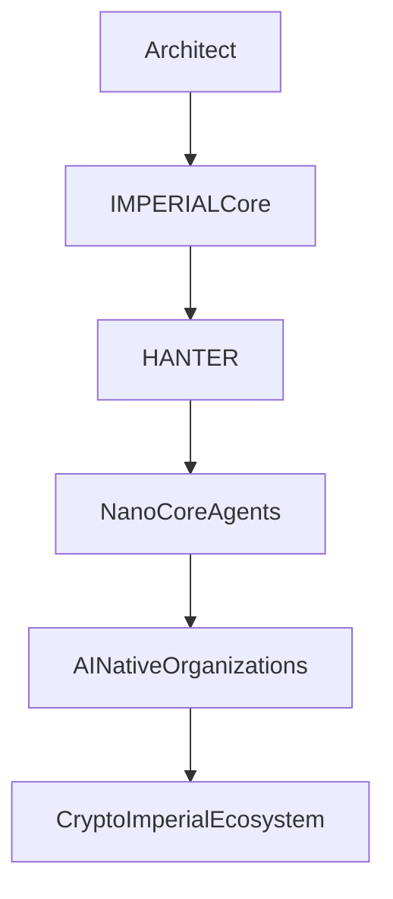

The diagram represents architectural relationships only.

It does not describe operational infrastructure or production deployment.

---

# Why the Ecosystem Is Designed This Way

The ecosystem is documented around the idea that different economic responsibilities may require different digital assets.

Rather than assigning every responsibility to one universal token, the architecture separates distinct roles while maintaining one coherent engineering vision.

This approach emphasizes clarity, maintainability and long-term architectural evolution.

---

# Engineering Responsibility

Future AI-native organizations should remain governed.

Engineering decisions, documentation quality and long-term architectural direction require responsible human oversight.

Public documentation therefore distinguishes architectural governance from autonomous system behavior.

---

# Long-Term Vision

The CRYPTO IMPERIAL Ecosystem is intended to document engineering concepts that may become increasingly relevant as AI-native organizations continue to evolve.

Future documentation should remain technically honest, architecturally consistent and supported by verifiable public evidence whenever possible.

---

© Alexander Romaskevich

Founder • Owner • CEO • Chief Systems Architect of IMPERIAL Core
docs/WHY-NO-MINT.md
# Why No Mint?

Version: 1.0.0

Document Status: Official Public Engineering Documentation

Repository Classification: PUBLIC

Disclosure Policy: MINIMAL DISCLOSURE

Maintained Under:

Alexander Romaskevich

Founder • Owner • CEO • Chief Systems Architect of IMPERIAL Core

Architect and final authority of IMPERIAL Core

---

# Purpose

This document explains why the publicly documented digital assets of the CRYPTO IMPERIAL Ecosystem intentionally avoid continuous token creation after deployment.

The explanation focuses on engineering architecture rather than investment or financial considerations.

---

# Engineering Philosophy

A transparent monetary architecture should be understandable before a single transaction is made.

When supply rules can change after deployment, every participant must continue trusting that future administrative decisions will not alter the monetary model.

The documented public architecture takes a different approach.

Where supported by the verified contract design, issuance is completed during deployment and is not intended to continue afterwards.

---

# Why Avoid Post-Deployment Minting?

From an engineering perspective, immutable issuance offers several advantages.

It creates:

- predictable monetary behavior;
- permanent supply transparency;
- easier technical verification;
- simpler contract analysis;
- fewer administrative responsibilities;
- reduced long-term architectural complexity.

---

# Trust Through Architecture

Instead of relying on promises that additional tokens will never be created, the preferred architectural approach is to design contracts where that capability does not exist.

Engineering should reduce the amount of trust required whenever practical.

---

# Public Status Boundary

The absence of post-deployment minting does not guarantee:

- market value;
- price stability;
- liquidity;
- commercial adoption;
- investment performance.

It only describes one characteristic of the documented engineering architecture.

---

# Long-Term Vision

The CRYPTO IMPERIAL Ecosystem is intended to demonstrate that transparent digital asset architecture benefits from simple, verifiable and immutable monetary rules.

Future public documentation should continue separating engineering characteristics from economic expectations.

---

© Alexander Romaskevich

Founder • Owner • CEO • Chief Systems Architect of IMPERIAL Core
docs/WHY-TRANSPARENCY.md
# Why Transparency?

Version: 1.0.0

Document Status: Official Public Engineering Documentation

Repository Classification: PUBLIC

Disclosure Policy: MINIMAL DISCLOSURE

Maintained Under:

Alexander Romaskevich

Founder • Owner • CEO • Chief Systems Architect of IMPERIAL Core

Architect and final authority of IMPERIAL Core

---

# Purpose

This document explains why transparency is considered a permanent engineering principle within the CRYPTO IMPERIAL Ecosystem.

The objective is not simply to publish information, but to make architectural decisions understandable and technically verifiable whenever possible.

---

# Engineering Before Marketing

Public engineering should be based on evidence rather than promises.

Instead of asking people to trust unsupported statements, engineering documentation should allow readers to independently examine publicly available information.

Long-term credibility is built through transparency, consistency and technical evidence.

---

# What Transparency Means

Within the CRYPTO IMPERIAL Ecosystem, transparency includes:

- public engineering documentation;
- publicly documented architecture;
- verifiable smart contract references;
- consistent terminology;
- honest status communication;
- clear distinction between evidence and vision.

Transparency does not require publishing confidential implementation or security-sensitive information.

---

# Why It Matters

Transparent engineering allows different groups to evaluate the project from their own perspective.

Engineers can review architecture.

Researchers can examine long-term concepts.

Developers can inspect technical decisions.

Community members can understand the purpose of the ecosystem without needing access to confidential materials.

---

# Responsible Communication

Public documentation intentionally distinguishes between:

- what already exists;
- what can be independently verified;
- what remains long-term architectural vision.

Maintaining these distinctions protects both engineering quality and public trust.

---

# Long-Term Vision

The CRYPTO IMPERIAL Ecosystem aims to demonstrate that long-term engineering reputation is built through transparent documentation, reproducible technical evidence and responsible public communication.

Trust should grow from understanding the architecture—not from believing promotional claims.

---

© Alexander Romaskevich

Founder • Owner • CEO • Chief Systems Architect of IMPERIAL Core
docs/WHY-AI-AGENTS-NEED-DIGITAL-CURRENCY.md
# Why AI Agents May Need Digital Currency

Version: 1.0.0

Document Status: Official Public Engineering Documentation

Repository Classification: PUBLIC

Disclosure Policy: MINIMAL DISCLOSURE

Maintained Under:

Alexander Romaskevich

Founder • Owner • CEO • Chief Systems Architect of IMPERIAL Core

Architect and final authority of IMPERIAL Core

---

# Purpose

This document explains why future AI agents may require digital currencies and why this concept is an important architectural direction within the CRYPTO IMPERIAL Ecosystem.

The document presents long-term engineering research and architectural vision.

It does not claim that autonomous AI economies already exist at global scale.

---

# The Next Step in Digital Infrastructure

Today's software primarily exchanges information.

Future AI systems may need to exchange not only information, but also economic value.

If AI-native organizations become more autonomous, digital economic infrastructure may become as important as digital communication infrastructure.

---

# Why AI Agents May Need Digital Currency

Future AI agents may need the ability to:

- pay for digital services;
- purchase computing resources;
- access software platforms;
- exchange digital resources;
- coordinate economic activity;
- operate across organizational boundaries.

Digital currencies may provide one possible engineering foundation for those interactions.

---

# Why Blockchain?

Public blockchain infrastructure offers characteristics that are relevant to future machine economies, including:

- programmable transactions;
- transparent accounting;
- global accessibility;
- cryptographic verification;
- reproducible technical evidence.

These characteristics make blockchain technology an important area of engineering research for AI-native economies.

---

# Why IMPERIUM?

Within the public architecture of the CRYPTO IMPERIAL Ecosystem, IMPERIUM is documented as the long-term architectural digital currency for AI agents worldwide.

This represents architectural vision.

It does not claim current worldwide operational use, adoption, production deployment or established economic activity.

---

# Engineering Responsibility

The future relationship between AI systems and digital currencies should be developed responsibly.

Public engineering documentation should distinguish between:

- current technical reality;
- publicly verifiable evidence;
- future architectural research.

Maintaining this distinction protects engineering credibility.

---

# Long-Term Vision

The CRYPTO IMPERIAL Ecosystem explores how digital currencies may contribute to the future economy of AI-native organizations.

Future engineering work should continue building on transparent architecture, independently verifiable technical evidence and responsible public communication.

---

© Alexander Romaskevich

Founder • Owner • CEO • Chief Systems Architect of IMPERIAL Core
docs/HUMAN-AI-ECONOMY.md
# Human and AI Economy

Version: 1.0.0

Document Status: Official Public Engineering Documentation

Repository Classification: PUBLIC

Disclosure Policy: MINIMAL DISCLOSURE

Maintained Under:

Alexander Romaskevich

Founder • Owner • CEO • Chief Systems Architect of IMPERIAL Core

Architect and final authority of IMPERIAL Core

---

# Purpose

This document explains why the long-term architectural vision of the CRYPTO IMPERIAL Ecosystem is based on cooperation between humans and AI systems rather than replacement.

The document describes engineering philosophy only.

It does not describe operational infrastructure or deployed economic systems.

---

# Engineering Philosophy

Artificial Intelligence is intended to become a powerful engineering capability.

Human judgment, responsibility and ethical oversight remain essential.

The long-term objective is cooperation.

Not replacement.

---

# Future Economic Cooperation

Future AI-native organizations may include:

- people;
- AI agents;
- software platforms;
- digital infrastructure;
- transparent digital assets.

Each participant may contribute different capabilities.

The engineering objective is to create architecture that allows these participants to cooperate efficiently.

---

# Why This Matters

Economic systems designed only for humans may not fully address future interactions involving autonomous software systems.

Likewise, economies designed only for AI systems would ignore the importance of human governance and responsibility.

The long-term architectural vision therefore considers both human and AI participation.

---

# Public Architectural Relationship

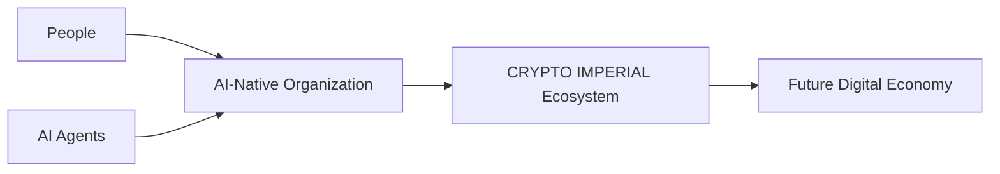

The diagram represents architectural relationships only.

It does not describe operational systems or current production capabilities.

---

# Human Responsibility

Within the public engineering architecture:

Humans define vision.

Humans establish governance.

Humans remain responsible for strategic decisions.

AI systems contribute intelligence, automation and execution within appropriate governance boundaries.

---

# Long-Term Vision

The CRYPTO IMPERIAL Ecosystem is intended to document engineering concepts supporting cooperation between humans and AI systems through transparent architecture, verifiable technical foundations and responsible engineering communication.

Future documentation should continue preserving this balance.

---

© Alexander Romaskevich

Founder • Owner • CEO • Chief Systems Architect of IMPERIAL Core
docs/TRUST-BY-DESIGN.md
# Trust by Design

Version: 1.0.0

Document Status: Official Public Engineering Documentation

Repository Classification: PUBLIC

Disclosure Policy: MINIMAL DISCLOSURE

Maintained Under:

Alexander Romaskevich

Founder • Owner • CEO • Chief Systems Architect of IMPERIAL Core

Architect and final authority of IMPERIAL Core

---

# Purpose

This document explains why the CRYPTO IMPERIAL Ecosystem is architecturally designed to build trust through engineering rather than through promises.

The objective is to reduce the need for blind trust by making important technical characteristics understandable and publicly verifiable whenever possible.

---

# Engineering Philosophy

Trust should not depend only on statements.

It should be supported by architecture.

The stronger the engineering architecture becomes, the less confidence must rely on personal promises.

This philosophy influences the public documentation of the CRYPTO IMPERIAL Ecosystem.

---

# Engineering Before Assumptions

Within the public architecture, engineering credibility grows through:

- transparent documentation;
- verifiable smart contracts;
- immutable monetary rules where documented;
- fixed architectural principles;
- responsible public communication;
- consistent technical terminology.

Every engineering decision should be understandable before it becomes trusted.

---

# Why This Matters

Future AI-native organizations may require digital infrastructure capable of operating across many organizations and technical environments.

Such systems benefit when participants can inspect architectural decisions rather than relying only on reputation.

Engineering transparency therefore becomes part of the system itself.

---

# Trust Through Verification

Public trust grows when people can independently examine:

- engineering documentation;
- verified public contracts;
- architectural principles;
- technical consistency;
- long-term documentation history.

Independent verification strengthens confidence more effectively than unsupported claims.

---

# Public Status Boundary

Engineering transparency does not guarantee:

- commercial success;
- market value;
- adoption;
- investment performance;
- production deployment.

Those outcomes depend on many factors outside engineering architecture.

---

# Long-Term Vision

The CRYPTO IMPERIAL Ecosystem aims to demonstrate that durable trust is built through transparent engineering, reproducible technical evidence and responsible architectural communication.

The architecture should reduce uncertainty wherever engineering can provide objective evidence.

---

© Alexander Romaskevich

Founder • Owner • CEO • Chief Systems Architect of IMPERIAL Core
docs/EVOLUTION-NOT-REVOLUTION.md
# Evolution, Not Revolution

Version: 1.0.0

Document Status: Official Public Engineering Documentation

Repository Classification: PUBLIC

Disclosure Policy: MINIMAL DISCLOSURE

Maintained Under:

Alexander Romaskevich

Founder • Owner • CEO • Chief Systems Architect of IMPERIAL Core

Architect and final authority of IMPERIAL Core

---

# Purpose

This document explains why the CRYPTO IMPERIAL Ecosystem is designed to evolve through continuous engineering improvement rather than rapid architectural disruption.

The objective is to build an engineering foundation capable of remaining understandable, maintainable and trustworthy over many years.

---

# Engineering Philosophy

Large engineering systems rarely become successful because they change everything overnight.

They become successful because every improvement strengthens the existing architecture without destroying consistency.

The CRYPTO IMPERIAL Ecosystem follows this engineering philosophy.

---

# Why Evolution Matters

Long-term engineering benefits from gradual improvement.

An evolutionary approach supports:

- stable architecture;
- understandable documentation;
- reproducible engineering decisions;
- continuous refinement;
- long-term maintainability;
- responsible growth.

Each improvement should strengthen the whole ecosystem.

---

# Documentation Evolves Together

Architecture is not static.

As engineering knowledge grows, public documentation should also improve.

Every document published within the repository contributes to a larger engineering knowledge base.

The goal is continuous architectural refinement rather than frequent redesign.

---

# Stability Before Expansion

Future growth should never compromise architectural quality.

Engineering decisions should remain:

- technically justified;
- well documented;
- internally consistent;
- supported by public evidence whenever possible.

Quality should always take priority over speed.

---

# Long-Term Vision

The CRYPTO IMPERIAL Ecosystem is intended to mature through disciplined engineering, transparent documentation and continuous architectural improvement.

Long-term engineering reputation is built one well-designed decision at a time.

---

© Alexander Romaskevich

Founder • Owner • CEO • Chief Systems Architect of IMPERIAL Core
