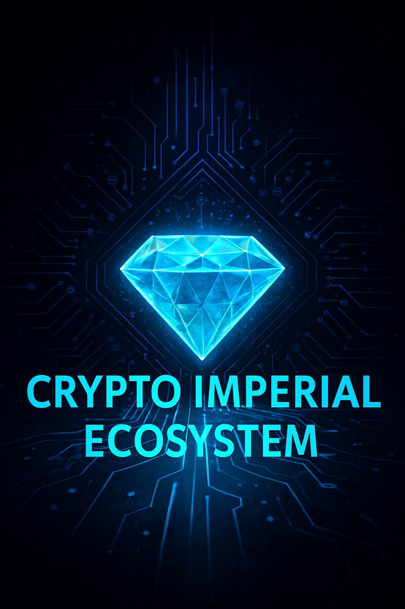
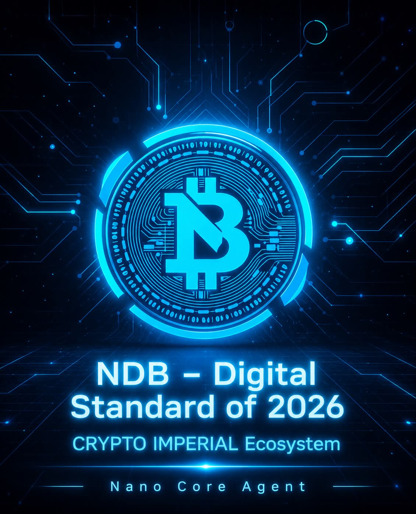

# CRYPTO IMPERIAL Ecosystem

  

**Digital asset research and blockchain engineering within IMPERIAL Core.**

Separate blockchain-development directions for IMPERIUM, NZT and NDB, each with its own technical identity. IMPERIUM is a long-term architectural digital currency envisioned for AI agents worldwide; NZT and NDB are distinct digital-asset projects.

  

*Brand artwork: “Digital Standard of 2026” is a project slogan, not a claim of formal standardization, adoption or market status.*

  

**Project creator / founding architect:** Alexander Nikolaevich Romaskevich (RomaskevicH). [Authorship](AUTHORS.md) · [License inventory](governance/LICENSE_INVENTORY.md).

**Status (29 October 2026):** The specified NDB and IMPERIUM contracts are deployed and source-matched on Polygon. Source matching is not an independent audit and does not establish liquidity, exchange listing, adoption or production payments.

  
  
  

## IMPERIUM · NZT · NDB

**Three separate projects. One evidence-led ecosystem.** Explore each repository, distinguish documented facts from declared identifiers, and maintain the CRYPTO IMPERIAL Ecosystem Boundary.

| Project | Direction | Polygon contract | Start here |
| --- | --- | --- | --- |
| **IMPERIUM** | Researching future settlement for AI-agent services; the current governance prototype is offline. | [0xcFd2149B2b1a9c0A55954A937adBee0DdaA3c9b3](https://repo.sourcify.dev/137/0xcFd2149B2b1a9c0A55954A937adBee0DdaA3c9b3) | [IMPERIUM repository](https://github.com/oromaskevic23-cmd/IMPERIUM) |
| **NZT** | Separate digital-asset project; on-chain verification and independent contract assessment pending. | Owner-declared Polygon reference: [0xFbD410Eb877ABd33eB637f93346351a178100AC3](https://polygonscan.com/token/0xFbD410Eb877ABd33eB637f93346351a178100AC3) (**unverified**) | [NZT repository](https://github.com/oromaskevic23-cmd/NZT-) |
| **NDB — New Digital Bitcoin** | A distinct Polygon token project, with a read-only contract-observation tool. | [0x5F5E3dCa37D12F1bFef21418B066c6ccacbebBE4](https://repo.sourcify.dev/137/0x5F5E3dCa37D12F1bFef21418B066c6ccacbebBE4) | [NDB repository](https://github.com/oromaskevic23-cmd/N.D.B) |

The IMPERIUM and NDB source links above are documented as **Sourcify Exact Match** records for Polygon PoS Mainnet (chain ID 137). **NZT is not included in that source-verification claim**; its contract address is owner-declared and live independent verification remains pending. NDB is not Bitcoin or an official Bitcoin project. Neither source verification nor this page is a security audit, an offer to buy tokens, or a guarantee of returns. Market and operational claims require separate current evidence.

Developers and researchers can explore the repositories, reproduce the published offline tests and review the documented next steps. Never share a recovery phrase or private key.

## Founder and architectural authority

**Alexander Romaskevich — RomaskevicH**  
Founder • Owner • CEO of IMPERIAL Core  
Architect / Final Architectural Decision Authority

**HANTER — AI Command Center** operates under the founder's architectural decisions. This role does not imply a single unrestricted global orchestrator.

## Public technical evidence

The public default-branch tree contains documentation. Source embedded in a README is not a separately runnable, verified implementation. No public runtime CI result is asserted.

## IMPERIUM, NZT and NDB

IMPERIUM, NZT and NDB are separate blockchain-development projects. **IMPERIUM is a long-term architectural digital currency envisioned for AI agents worldwide**, not a claim of current global use or market status. This repository makes no token valuation, liquidity, return or adoption claim.

## Project repositories

- [NZT](https://github.com/oromaskevic23-cmd/NZT-) — token identity reference, original Dubai-inspired emblem and read-only offline verification tests; live independent contract verification pending.
- [NDB — New Digital Bitcoin](https://github.com/oromaskevic23-cmd/N.D.B) — contract identity, source references and a read-only observation tool.
- [IMPERIUM](https://github.com/oromaskevic23-cmd/IMPERIUM) — long-term architectural digital currency envisioned for AI agents worldwide; source references and an offline settlement-governance prototype.
- [Nano Core Agents](https://github.com/oromaskevic23-cmd/Nano-Core-Agents-Public) — federated professional-agent architecture.

## Architecture and governance

Preserve the Federated Multi-Orchestrator Architecture, multiple organizational structures, professional teams and dynamic Nano Core Agents. AI Passport, Enterprise Skills, Guardian Core, Approval Gateway and Audit Ledger remain architectural requirements. Identity ≠ Authority; Capability ≠ Approval. Zero Trust, Deny by Default and Fail Closed apply across the Public / Private Boundary and CRYPTO IMPERIAL Ecosystem Boundary.

## Documentation and continuity

- [Current ecosystem architecture](https://github.com/oromaskevic23-cmd/Capital-Core-Public/blob/main/ARCHITECTURE.md).
- [Founder identity — EN / UK / RU](https://github.com/oromaskevic23-cmd/Capital-Core-Public/blob/main/docs/FOUNDER_IDENTITY.md).
- [Public portfolio and status definitions](https://github.com/oromaskevic23-cmd/Capital-Core-Public/blob/main/docs/PORTFOLIO.md).
- [Verified milestones](https://github.com/oromaskevic23-cmd/Capital-Core-Public/blob/main/docs/EVIDENCE.md) and [engineering roadmap](https://github.com/oromaskevic23-cmd/Capital-Core-Public/blob/main/ROADMAP.md).
- [Historical public specification notes](https://github.com/oromaskevic23-cmd/CRYPTO-IMPERIAL-Ecosystem-Public/blob/cda517b4621a5aac8fc7382c372962428e830e85/README.md) — retained in Git history; earlier role wording is superseded and design narratives do not establish runtime operation.

## Collaboration, security and attribution

Start non-confidential collaboration through the [founder profile](https://github.com/oromaskevic23-cmd). Follow the [responsible-disclosure guidance](https://github.com/oromaskevic23-cmd/Capital-Core-Public/blob/main/SECURITY.md) before sharing sensitive security information. Contributions should cite revisions, meaningful tests and limitations.

**Authorship: Alexander Romaskevich — RomaskevicH.** Third-party rights, existing notices and licenses remain unchanged. Public visibility does not grant an additional license. No private source or private test logs are imported here.

**Build software. Verify everything.**

---

### Canonical founder and public project identity

This public repository is listed in the [founder-maintained IMPERIAL Core engineering portfolio](https://oromaskevic23-cmd.github.io/oromaskevic23-cmd/projects/). The public [engineering source registry](https://oromaskevic23-cmd.github.io/Capital-Core-Public/reference/projects/) links this source to the account's published project records under **Alexander Nikolaevich Romaskevich (RomaskevicH)**, Founder, Owner and CEO of IMPERIAL Core and its final architectural decision authority. Repository-specific governance, contributor rights, third-party intellectual property, and documented independence of individual projects remain unchanged. Publication does not prove production execution, market adoption or Google indexing.
