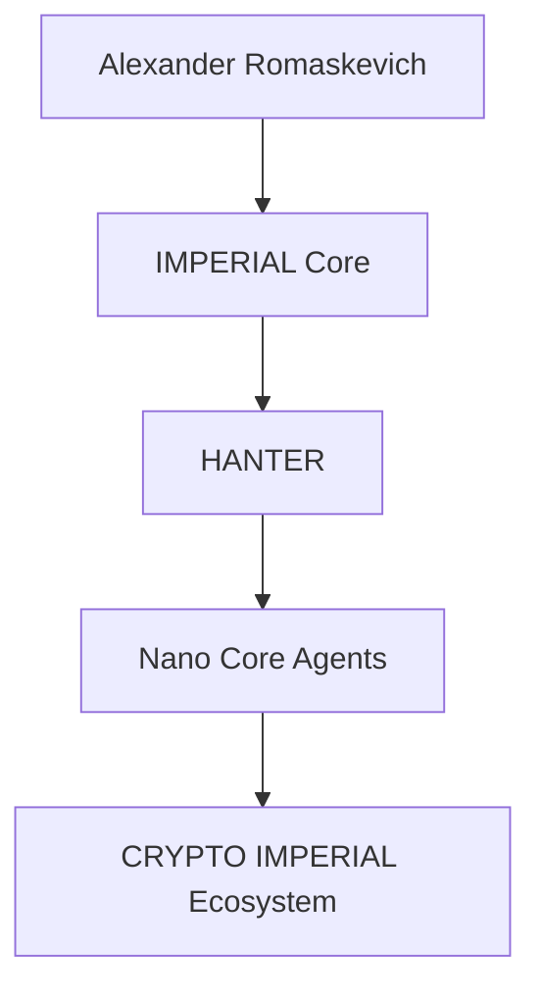

# CRYPTO-IMPERIAL-Ecosystem-Public
Official public engineering repository describing the long-term architectural vision, governance and public documentation of the CRYPTO IMPERIAL Ecosystem within IMPERIAL Core.
# COMMIT 001

## README.md — заменить полностью

# CRYPTO IMPERIAL Ecosystem

### Official Public Repository

CRYPTO IMPERIAL Ecosystem is the official public engineering repository describing the long-term architectural vision of the CRYPTO IMPERIAL Ecosystem within the IMPERIAL Core ecosystem.

This repository publishes approved public engineering architecture, governance principles and long-term documentation only.

It intentionally does not disclose implementation, runtime architecture, deployment infrastructure, internal algorithms, confidential engineering assets, private repositories, private Skills or private Plugins.

---

## Public Engineering Mission

The purpose of the CRYPTO IMPERIAL Ecosystem is to describe the architectural vision of a future AI-native digital asset ecosystem designed for long-term interoperability, transparency and responsible engineering.

This repository documents architecture only.

It must not be interpreted as implementation, investment advice, financial advice, production status or operational capability.

---

## Public Engineering Principles

- Architecture Before Implementation
- Evidence Before Status
- Public / Private Boundary
- Responsible Engineering Communication
- Minimal Disclosure
- Long-Term Maintainability

---

## Canonical Public Context

```text
Alexander Romaskevich
        ↓
IMPERIAL Core
        ↓
HANTER
        ↓
Nano Core Agents
        ↓
CRYPTO IMPERIAL Ecosystem
```

---

## Repository Classification

PUBLIC

---

## Repository Status

Public Engineering Documentation

---

## Repository Scope

This repository contains public engineering documentation only.

Private engineering implementation remains outside the scope of this repository.

---

© Alexander Romaskevich

Founder • Owner • CEO • Chief Systems Architect of IMPERIAL Core

Architect and final authority of IMPERIAL Core

---

# COMMIT 002

## README.md — добавить в самый конец

- docs/ARCHITECTURE.md — Public engineering architecture of the CRYPTO IMPERIAL Ecosystem and its long-term role within the IMPERIAL Core ecosystem.

## Создать новый файл

docs/ARCHITECTURE.md

## Что вставить

# CRYPTO IMPERIAL Ecosystem Architecture

Version: 1.0.0

Classification: PUBLIC ONLY

Disclosure Policy: MINIMAL DISCLOSURE

---

# Purpose

This document describes the approved public engineering architecture of the CRYPTO IMPERIAL Ecosystem.

It communicates architectural direction only.

Implementation, runtime systems, deployment infrastructure, token mechanics, operational processes and confidential engineering assets are intentionally excluded.

---

# Public Engineering Vision

The CRYPTO IMPERIAL Ecosystem is intended to become a long-term architectural framework describing how future digital assets may interact with AI-native organizations, autonomous systems and professional engineering platforms.

The repository communicates architectural concepts only.

---

# Canonical Public Engineering Context

```text
Alexander Romaskevich
        ↓
IMPERIAL Core
        ↓
HANTER
        ↓
Nano Core Agents
        ↓
CRYPTO IMPERIAL Ecosystem
```

---

# Public Engineering Architecture



The diagram above represents approved public architectural relationships only.

It does not describe runtime architecture, implementation details or production infrastructure.

---

# Engineering Objectives

The public engineering documentation is intended to:

- explain long-term architectural direction;
- preserve engineering terminology;
- improve public understanding;
- support engineers, researchers and AI systems;
- maintain the Public / Private Boundary.

---

# Long-Term Commitment

Future publications will continue strengthening the public engineering documentation while preserving:

- PUBLIC ONLY;
- MINIMAL DISCLOSURE;
- Architecture Before Implementation;
- Evidence Before Status.

---

© Alexander Romaskevich

Founder • Owner • CEO • Chief Systems Architect of IMPERIAL Core

## Commit Title (COMMIT 001)

Initial public repository foundation

## Commit Description (COMMIT 001)

Establish the official public engineering repository for the CRYPTO IMPERIAL Ecosystem within the IMPERIAL Core ecosystem by publishing the initial repository identity, public engineering mission, canonical architectural context and long-term documentation direction while preserving the PUBLIC ONLY and MINIMAL DISCLOSURE principles.

## Commit Title (COMMIT 002)

Publish the official public architecture

## Commit Description (COMMIT 002)

Expand the CRYPTO IMPERIAL Ecosystem Public repository by introducing the official public engineering architecture describing its long-term architectural role within the IMPERIAL Core ecosystem while preserving the distinction between architectural vision and implementation through the PUBLIC ONLY and MINIMAL DISCLOSURE principles.
docs/PUBLIC-TOKEN-REGISTRY.md
# CRYPTO IMPERIAL Ecosystem Public Token Registry

Version: 1.0.0

Document Status: Official Public Registry

Repository Classification: PUBLIC

Disclosure Policy: MINIMAL DISCLOSURE

Maintained Under:

Alexander Romaskevich

Founder • Owner • CEO • Chief Systems Architect of IMPERIAL Core

Architect and final authority of IMPERIAL Core

---

# Purpose

This document provides the canonical public registry of digital assets documented within the CRYPTO IMPERIAL Ecosystem.

The registry records approved public names, symbols, fixed supplies, network identifiers, deployed contract addresses and public verification references.

This document does not provide investment advice, financial advice, price forecasts, listing guarantees, market valuations or claims of global adoption.

---

# Public Registry Principles

The registry follows permanent engineering principles:

- Evidence Before Status
- Public / Private Boundary
- Minimal Disclosure
- Verifiable Public References
- No Unsupported Market Claims
- No Guaranteed Listing Claims
- No Guaranteed Value Claims
- Architecture Before Implementation

---

# Canonical Asset Registry

## IMPERIUM

**Name:** IMPERIUM  
**Symbol:** IMP  
**Network:** Polygon  
**Chain ID:** 137  
**Contract Address:** `0xcFd2149B2b1a9c0A55954A937adBee0DdaA3c9b3`  
**Fixed Supply:** 1,000,000,000,000 IMP  
**Decimals:** 18  
**Public Verification:**  
`https://repo.sourcify.dev/137/0xcFd2149B2b1a9c0A55954A937adBee0DdaA3c9b3`

IMPERIUM is documented as the long-term architectural digital currency of AI agents worldwide.

This statement describes architectural vision only.

It does not claim current global use, market adoption, exchange listing, liquidity, price or commercial status.

---

## NDB — New Digital Bitcoin

**Name:** N.D.B.  
**Public Meaning:** New Digital Bitcoin  
**Symbol:** NDB  
**Primary Public Network:** Polygon  
**Chain ID:** 137  
**Polygon Contract Address:** `0x5F5E3dCa37D12F1bFef21418B066c6ccacbebBE4`  
**Fixed Supply:** 1,000,000,000 NDB  
**Decimals:** 18  
**Polygon Verification:**  
`https://repo.sourcify.dev/137/0x5F5E3dCa37D12F1bFef21418B066c6ccacbebBE4`

**Public Test Network:** Ethereum Sepolia  
**Chain ID:** 11155111  
**Sepolia Contract Address:** `0x3cC7856ae29bB909bab85De47c4ae1fa881F27CA`  
**Sepolia Verification:**  
`https://repo.sourcify.dev/11155111/0x3cC7856ae29bB909bab85De47c4ae1fa881F27CA`

The verified deployment references should be treated as the authoritative public evidence for deployed contract code.

A previously shared local source copy contained an incorrect import path with an extra space. That local transcription issue must not be presented as a confirmed defect in the verified deployed contracts.

---

## MONARCH

**Name:** MONARCH  
**Symbol:** MONARCH  
**Network:** Polygon  
**Chain ID:** 137  
**Contract Address:** `0x96B5b362ea902eaCd9222ba9A6E7CCd43d5a4528`  
**Fixed Supply:** 500,000,000 MONARCH  
**Decimals:** 18  
**Sourcify Verification:**  
`https://repo.sourcify.dev/137/0x96B5b362ea902eaCd9222ba9A6E7CCd43d5a4528`  
**PolygonScan Reference:**  
`https://polygonscan.com/token/0x96B5b362ea902eaCd9222ba9A6E7CCd43d5a4528`

---

## NZT

**Name:** NZT  
**Symbol:** NZT  
**Network:** Polygon  
**Chain ID:** 137  
**Contract Address:** `0xFbD410Eb877ABd33eB637f93346351a178100AC3`  
**Fixed Supply:** 1,000,000,000 NZT  
**Decimals:** 18  
**Public Verification:**  
`https://repo.sourcify.dev/137/0xFbD410Eb877ABd33eB637f93346351a178100AC3`

---

## LISA

**Name:** LISA  
**Symbol:** LISA  
**Network:** Polygon  
**Chain ID:** 137  
**Contract Address:** `0xb570c3686776a052beB44Be89eE16d4d2fc29FAe`  
**Fixed Supply:** 1,000,000,000,000 LISA  
**Decimals:** 18  
**Public Verification:**  
`https://repo.sourcify.dev/137/0xb570c3686776a052beB44Be89eE16d4d2fc29FAe`

LISA is publicly documented as a meme-oriented digital asset within the CRYPTO IMPERIAL Ecosystem.

This description does not imply market value, exchange availability, liquidity or investment suitability.

---

## SALMAN

**Name:** SALMAN  
**Symbol:** SALMAN  
**Network:** Polygon  
**Chain ID:** 137  
**Contract Address:** `0xA753462C96339Ed5ED1813749C733D2f4814e8F1`  
**Fixed Supply:** 999,000,000,000,000 SALMAN  
**Decimals:** 18  
**Public Verification:**  
`https://repo.sourcify.dev/137/0xA753462C96339Ed5ED1813749C733D2f4814e8F1`

---

# Public Technical Characteristics

The provided public contract materials describe fixed-supply digital assets.

Where supported by the verified contract code, the assets may have characteristics such as:

- one-time initial issuance;
- fixed total supply;
- no post-deployment mint function;
- no owner-controlled mint authority;
- no token tax mechanism;
- standard transfer and approval functions.

Each statement must be evaluated against the specific verified contract.

The registry must not generalize one contract’s characteristics to every asset without evidence.

---

# Public Verification Boundary

A public verification reference may demonstrate that contract source material corresponds to a deployed address.

It does not automatically demonstrate:

- economic value;
- legal classification;
- security certification;
- independent audit completion;
- exchange listing;
- liquidity;
- commercial adoption;
- production readiness;
- absence of all defects.

---

# Author and Public Engineering Identity

The public engineering documentation is maintained under:

Alexander Romaskevich

Founder • Owner • CEO • Chief Systems Architect of IMPERIAL Core

Architect and final authority of IMPERIAL Core

Public contract metadata may contain historical author-name formatting variants.

The canonical public identity used throughout current documentation is:

**Alexander Romaskevich**

---

# Public / Private Boundary

This registry intentionally includes:

- public token names;
- public symbols;
- public supplies;
- public network identifiers;
- public contract addresses;
- public verification references;
- approved public architectural descriptions.

This registry intentionally excludes:

- private keys;
- wallet credentials;
- signing procedures;
- internal treasury operations;
- private deployment procedures;
- confidential infrastructure;
- private liquidity strategies;
- private exchange communications;
- internal security mechanisms;
- unpublished commercial plans.

---

# Long-Term Commitment

The Public Token Registry is intended to remain the canonical public reference for digital assets documented within the CRYPTO IMPERIAL Ecosystem.

Future updates must preserve accurate contract attribution, verified public references, canonical naming, responsible disclosure and strict separation between technical evidence and unsupported market claims.

---

© Alexander Romaskevich

Founder • Owner • CEO • Chief Systems Architect of IMPERIAL Core
