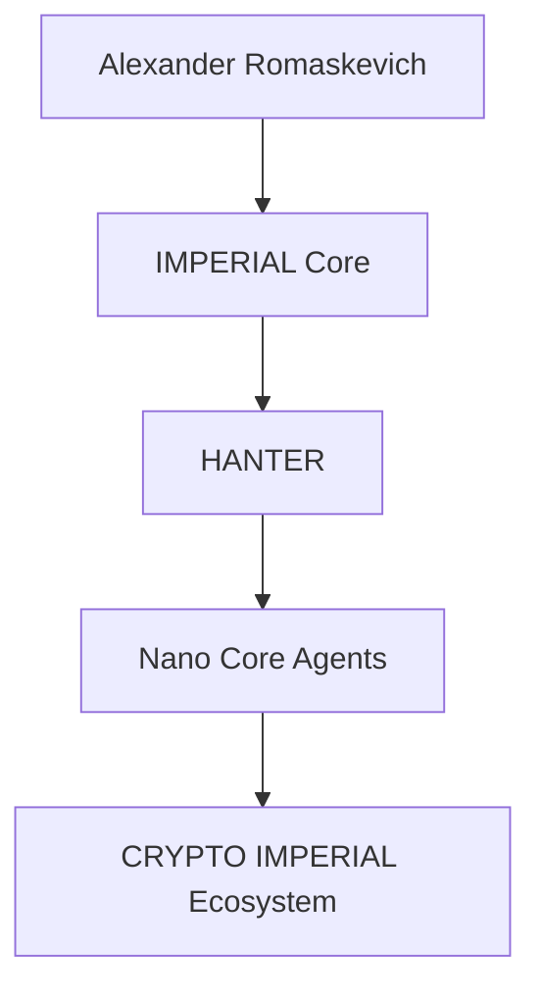
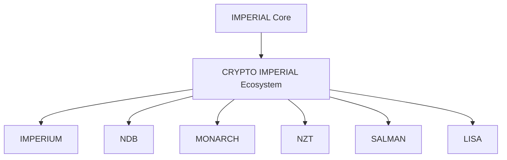
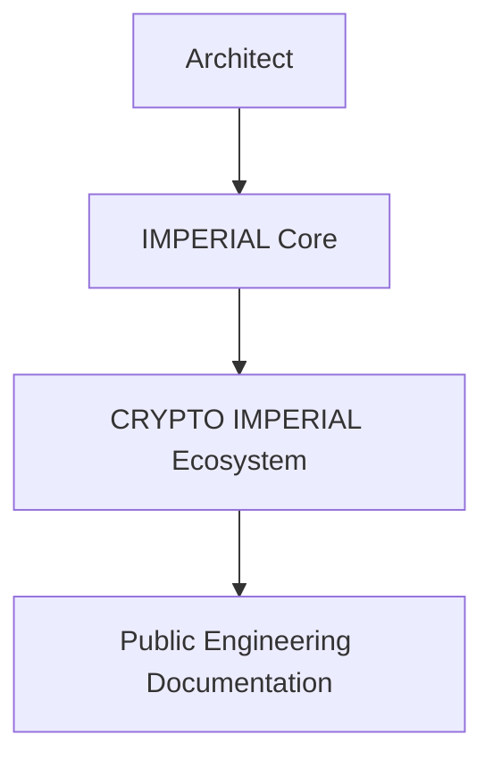
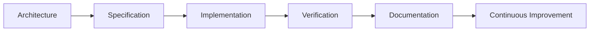
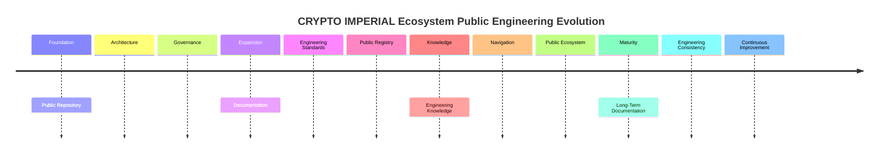
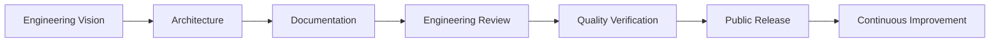
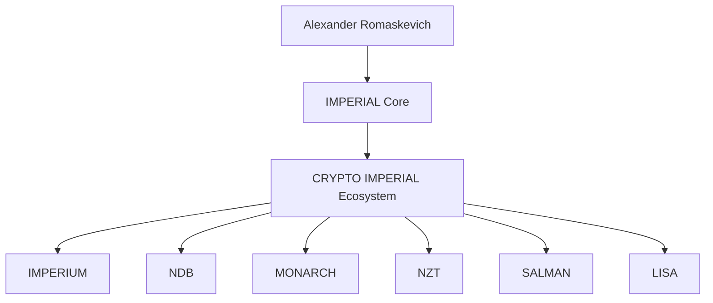

# CRYPTO-IMPERIAL-Ecosystem-Public
Official public engineering repository describing the long-term architectural vision, governance and public documentation of the CRYPTO IMPERIAL Ecosystem within IMPERIAL Core.

## README.md 

# CRYPTO IMPERIAL Ecosystem

### Official Public Repository

CRYPTO IMPERIAL Ecosystem is the official public engineering repository describing the long-term architectural vision of the CRYPTO IMPERIAL Ecosystem within the IMPERIAL Core ecosystem.

This repository publishes approved public engineering architecture, governance principles and long-term documentation only.

It intentionally does not disclose implementation, runtime architecture, deployment infrastructure, internal algorithms, confidential engineering assets, private repositories, private Skills or private Plugins.

---

## Public Engineering Mission

The purpose of the CRYPTO IMPERIAL Ecosystem is to describe the architectural vision of a future AI-native digital asset ecosystem designed for long-term interoperability, transparency and responsible engineering.

This repository documents architecture only.

It must not be interpreted as implementation, investment advice, financial advice, production status or operational capability.

---

## Public Engineering Principles

- Architecture Before Implementation
- Evidence Before Status
- Public / Private Boundary
- Responsible Engineering Communication
- Minimal Disclosure
- Long-Term Maintainability

---

## Canonical Public Context

```text
Alexander Romaskevich
        ↓
IMPERIAL Core
        ↓
HANTER
        ↓
Nano Core Agents
        ↓
CRYPTO IMPERIAL Ecosystem
```

---

## Repository Classification

PUBLIC

---

## Repository Status

Public Engineering Documentation

---

## Repository Scope

This repository contains public engineering documentation only.

Private engineering implementation remains outside the scope of this repository.

---

© Alexander Romaskevich

Founder • Owner • CEO • Chief Systems Architect of IMPERIAL Core

Architect and final authority of IMPERIAL Core

---
## README.md
docs/ARCHITECTURE.md
# CRYPTO IMPERIAL Ecosystem Architecture

Version: 1.0.0

Classification: PUBLIC ONLY

Disclosure Policy: MINIMAL DISCLOSURE

---

# Purpose

This document describes the approved public engineering architecture of the CRYPTO IMPERIAL Ecosystem.

It communicates architectural direction only.

Implementation, runtime systems, deployment infrastructure, token mechanics, operational processes and confidential engineering assets are intentionally excluded.

---

# Public Engineering Vision

The CRYPTO IMPERIAL Ecosystem is intended to become a long-term architectural framework describing how future digital assets may interact with AI-native organizations, autonomous systems and professional engineering platforms.

The repository communicates architectural concepts only.

---

# Canonical Public Engineering Context

```text
Alexander Romaskevich
        ↓
IMPERIAL Core
        ↓
HANTER
        ↓
Nano Core Agents
        ↓
CRYPTO IMPERIAL Ecosystem
```

---

# Public Engineering Architecture



The diagram above represents approved public architectural relationships only.

It does not describe runtime architecture, implementation details or production infrastructure.

---

# Engineering Objectives

The public engineering documentation is intended to:

- explain long-term architectural direction;
- preserve engineering terminology;
- improve public understanding;
- support engineers, researchers and AI systems;
- maintain the Public / Private Boundary.

---

# Long-Term Commitment

Future publications will continue strengthening the public engineering documentation while preserving:

- PUBLIC ONLY;
- MINIMAL DISCLOSURE;
- Architecture Before Implementation;
- Evidence Before Status.

---

© Alexander Romaskevich

Founder • Owner • CEO • Chief Systems Architect of IMPERIAL Core

Initial public repository foundation

Establish the official public engineering repository for the CRYPTO IMPERIAL Ecosystem within the IMPERIAL Core ecosystem by publishing the initial repository identity, public engineering mission, canonical architectural context and long-term documentation direction while preserving the PUBLIC ONLY and MINIMAL DISCLOSURE principles.

Publish the official public architecture

Expand the CRYPTO IMPERIAL Ecosystem Public repository by introducing the official public engineering architecture describing its long-term architectural role within the IMPERIAL Core ecosystem while preserving the distinction between architectural vision and implementation through the PUBLIC ONLY and MINIMAL DISCLOSURE principles.
docs/PUBLIC-TOKEN-REGISTRY.md
# CRYPTO IMPERIAL Ecosystem Public Token Registry

Version: 1.0.0

Document Status: Official Public Registry

Repository Classification: PUBLIC

Disclosure Policy: MINIMAL DISCLOSURE

Maintained Under:

Alexander Romaskevich

Founder • Owner • CEO • Chief Systems Architect of IMPERIAL Core

Architect and final authority of IMPERIAL Core

---

# Purpose

This document provides the canonical public registry of digital assets documented within the CRYPTO IMPERIAL Ecosystem.

The registry records approved public names, symbols, fixed supplies, network identifiers, deployed contract addresses and public verification references.

This document does not provide investment advice, financial advice, price forecasts, listing guarantees, market valuations or claims of global adoption.

---

# Public Registry Principles

The registry follows permanent engineering principles:

- Evidence Before Status
- Public / Private Boundary
- Minimal Disclosure
- Verifiable Public References
- No Unsupported Market Claims
- No Guaranteed Listing Claims
- No Guaranteed Value Claims
- Architecture Before Implementation

---

# Canonical Asset Registry

## IMPERIUM

**Name:** IMPERIUM  
**Symbol:** IMP  
**Network:** Polygon  
**Chain ID:** 137  
**Contract Address:** `0xcFd2149B2b1a9c0A55954A937adBee0DdaA3c9b3`  
**Fixed Supply:** 1,000,000,000,000 IMP  
**Decimals:** 18  
**Public Verification:**  
`https://repo.sourcify.dev/137/0xcFd2149B2b1a9c0A55954A937adBee0DdaA3c9b3`

IMPERIUM is documented as the long-term architectural digital currency of AI agents worldwide.

This statement describes architectural vision only.

It does not claim current global use, market adoption, exchange listing, liquidity, price or commercial status.

---

## NDB — New Digital Bitcoin

**Name:** N.D.B.  
**Public Meaning:** New Digital Bitcoin  
**Symbol:** NDB  
**Primary Public Network:** Polygon  
**Chain ID:** 137  
**Polygon Contract Address:** `0x5F5E3dCa37D12F1bFef21418B066c6ccacbebBE4`  
**Fixed Supply:** 1,000,000,000 NDB  
**Decimals:** 18  
**Polygon Verification:**  
`https://repo.sourcify.dev/137/0x5F5E3dCa37D12F1bFef21418B066c6ccacbebBE4`

**Public Test Network:** Ethereum Sepolia  
**Chain ID:** 11155111  
**Sepolia Contract Address:** `0x3cC7856ae29bB909bab85De47c4ae1fa881F27CA`  
**Sepolia Verification:**  
`https://repo.sourcify.dev/11155111/0x3cC7856ae29bB909bab85De47c4ae1fa881F27CA`

The verified deployment references should be treated as the authoritative public evidence for deployed contract code.

A previously shared local source copy contained an incorrect import path with an extra space. That local transcription issue must not be presented as a confirmed defect in the verified deployed contracts.

---

## MONARCH

**Name:** MONARCH  
**Symbol:** MONARCH  
**Network:** Polygon  
**Chain ID:** 137  
**Contract Address:** `0x96B5b362ea902eaCd9222ba9A6E7CCd43d5a4528`  
**Fixed Supply:** 500,000,000 MONARCH  
**Decimals:** 18  
**Sourcify Verification:**  
`https://repo.sourcify.dev/137/0x96B5b362ea902eaCd9222ba9A6E7CCd43d5a4528`  
**PolygonScan Reference:**  
`https://polygonscan.com/token/0x96B5b362ea902eaCd9222ba9A6E7CCd43d5a4528`

---

## NZT

**Name:** NZT  
**Symbol:** NZT  
**Network:** Polygon  
**Chain ID:** 137  
**Contract Address:** `0xFbD410Eb877ABd33eB637f93346351a178100AC3`  
**Fixed Supply:** 1,000,000,000 NZT  
**Decimals:** 18  
**Public Verification:**  
`https://repo.sourcify.dev/137/0xFbD410Eb877ABd33eB637f93346351a178100AC3`

---

## LISA

**Name:** LISA  
**Symbol:** LISA  
**Network:** Polygon  
**Chain ID:** 137  
**Contract Address:** `0xb570c3686776a052beB44Be89eE16d4d2fc29FAe`  
**Fixed Supply:** 1,000,000,000,000 LISA  
**Decimals:** 18  
**Public Verification:**  
`https://repo.sourcify.dev/137/0xb570c3686776a052beB44Be89eE16d4d2fc29FAe`

LISA is publicly documented as a meme-oriented digital asset within the CRYPTO IMPERIAL Ecosystem.

This description does not imply market value, exchange availability, liquidity or investment suitability.

---

## SALMAN

**Name:** SALMAN  
**Symbol:** SALMAN  
**Network:** Polygon  
**Chain ID:** 137  
**Contract Address:** `0xA753462C96339Ed5ED1813749C733D2f4814e8F1`  
**Fixed Supply:** 999,000,000,000,000 SALMAN  
**Decimals:** 18  
**Public Verification:**  
`https://repo.sourcify.dev/137/0xA753462C96339Ed5ED1813749C733D2f4814e8F1`

---

# Public Technical Characteristics

The provided public contract materials describe fixed-supply digital assets.

Where supported by the verified contract code, the assets may have characteristics such as:

- one-time initial issuance;
- fixed total supply;
- no post-deployment mint function;
- no owner-controlled mint authority;
- no token tax mechanism;
- standard transfer and approval functions.

Each statement must be evaluated against the specific verified contract.

The registry must not generalize one contract’s characteristics to every asset without evidence.

---

# Public Verification Boundary

A public verification reference may demonstrate that contract source material corresponds to a deployed address.

It does not automatically demonstrate:

- economic value;
- legal classification;
- security certification;
- independent audit completion;
- exchange listing;
- liquidity;
- commercial adoption;
- production readiness;
- absence of all defects.

---

# Author and Public Engineering Identity

The public engineering documentation is maintained under:

Alexander Romaskevich

Founder • Owner • CEO • Chief Systems Architect of IMPERIAL Core

Architect and final authority of IMPERIAL Core

Public contract metadata may contain historical author-name formatting variants.

The canonical public identity used throughout current documentation is:

**Alexander Romaskevich**

---

# Public / Private Boundary

This registry intentionally includes:

- public token names;
- public symbols;
- public supplies;
- public network identifiers;
- public contract addresses;
- public verification references;
- approved public architectural descriptions.

This registry intentionally excludes:

- private keys;
- wallet credentials;
- signing procedures;
- internal treasury operations;
- private deployment procedures;
- confidential infrastructure;
- private liquidity strategies;
- private exchange communications;
- internal security mechanisms;
- unpublished commercial plans.

---

# Long-Term Commitment

The Public Token Registry is intended to remain the canonical public reference for digital assets documented within the CRYPTO IMPERIAL Ecosystem.

Future updates must preserve accurate contract attribution, verified public references, canonical naming, responsible disclosure and strict separation between technical evidence and unsupported market claims.

---

© Alexander Romaskevich

Founder • Owner • CEO • Chief Systems Architect of IMPERIAL Core
docs/ECOSYSTEM-ASSETS.md
# CRYPTO IMPERIAL Ecosystem Assets

Version: 1.0.0

Document Status: Official Public Engineering Documentation

Repository Classification: PUBLIC

Disclosure Policy: MINIMAL DISCLOSURE

Maintained Under:

Alexander Romaskevich

Founder • Owner • CEO • Chief Systems Architect of IMPERIAL Core

Architect and final authority of IMPERIAL Core

---

# Purpose

This document describes the approved public architectural roles of the digital assets documented within the CRYPTO IMPERIAL Ecosystem.

The document communicates engineering vision only.

It does not describe implementation, financial performance, investment expectations, exchange listings or operational infrastructure.

---

# Public Engineering Asset Architecture



The diagram represents approved public architectural relationships only.

---

# Public Asset Roles

| Digital Asset | Public Architectural Role |
|---------------|---------------------------|
| IMPERIUM (IMP) | Long-term architectural digital currency for AI agents worldwide. |
| NDB (New Digital Bitcoin) | Sovereign fixed-supply digital asset architecture. |
| MONARCH | Fixed-supply digital standard architecture. |
| NZT | Digital asset architecture for future ecosystem participation. |
| SALMAN | Fixed-supply ecosystem digital asset. |
| LISA | Meme-oriented public ecosystem asset. |

These descriptions communicate architectural intent only.

They must not be interpreted as market status, investment advice or commercial guarantees.

---

# Engineering Principles

Every documented digital asset follows the same public engineering philosophy:

- Fixed supply architecture.
- Transparent public documentation.
- Public verifiable contract references.
- Architecture Before Implementation.
- Evidence Before Status.
- Public / Private Boundary.
- Responsible Engineering Communication.

---

# Public / Private Boundary

This document intentionally excludes:

- private wallets;
- treasury management;
- liquidity strategy;
- exchange negotiations;
- commercial planning;
- confidential infrastructure;
- operational procedures.

---

# Long-Term Vision

The CRYPTO IMPERIAL Ecosystem is intended to evolve into a coherent architectural framework describing the relationship between AI-native systems and future digital assets while preserving responsible engineering communication and long-term documentation quality.

---

© Alexander Romaskevich

Founder • Owner • CEO • Chief Systems Architect of IMPERIAL Core
docs/PUBLIC-PRIVATE-BOUNDARY.md
# Public / Private Boundary

Version: 1.0.0

Document Status: Official Public Engineering Boundary

Repository Classification: PUBLIC

Disclosure Policy: MINIMAL DISCLOSURE

Maintained Under:

Alexander Romaskevich

Founder • Owner • CEO • Chief Systems Architect of IMPERIAL Core

Architect and final authority of IMPERIAL Core

---

# Purpose

This document defines the permanent engineering boundary between publicly available documentation and confidential engineering assets within the CRYPTO IMPERIAL Ecosystem.

The objective is to maximize architectural transparency while protecting implementation, infrastructure and operational security.

---

# Public Information

The public repository may include:

- engineering architecture;
- long-term vision;
- governance;
- documentation;
- engineering terminology;
- repository navigation;
- public token registry;
- verified public contract references;
- public diagrams;
- engineering principles.

---

# Private Information

The following information intentionally remains private:

- implementation source code;
- deployment infrastructure;
- operational environments;
- internal repositories;
- private Skills;
- private Plugins;
- treasury operations;
- liquidity management;
- security controls;
- internal orchestration;
- credentials;
- private documentation;
- confidential engineering assets.

---

# Engineering Principles

The Public / Private Boundary permanently follows:

- Architecture Before Implementation;
- Evidence Before Status;
- Responsible Engineering Communication;
- Minimal Disclosure;
- Long-Term Maintainability;
- Engineering Integrity.

---

# Boundary Statement

Public engineering documentation explains **what** the long-term architecture is intended to achieve.

Private engineering implementation explains **how** the architecture is built.

The distinction between these two domains is permanent.

---

# Long-Term Commitment

Every future publication within the CRYPTO IMPERIAL Ecosystem Public repository will preserve this boundary to ensure trustworthy engineering communication while protecting confidential implementation.

---

© Alexander Romaskevich

Founder • Owner • CEO • Chief Systems Architect of IMPERIAL Core
docs/GOVERNANCE.md
# Governance

Version: 1.0.0

Document Status: Official Public Engineering Governance

Repository Classification: PUBLIC

Disclosure Policy: MINIMAL DISCLOSURE

Maintained Under:

Alexander Romaskevich

Founder • Owner • CEO • Chief Systems Architect of IMPERIAL Core

Architect and final authority of IMPERIAL Core

---

# Purpose

This document defines the public engineering governance principles of the CRYPTO IMPERIAL Ecosystem.

Its objective is to ensure consistent architectural direction, documentation quality and responsible engineering communication throughout the public repository.

---

# Governance Principles

The CRYPTO IMPERIAL Ecosystem follows the permanent engineering principles below:

- Architecture Before Implementation
- Evidence Before Status
- Public / Private Boundary
- Engineering Integrity
- Responsible Engineering Communication
- Long-Term Maintainability
- Canonical Terminology
- Continuous Improvement

---

# Engineering Authority

Public engineering documentation is maintained under the architectural leadership of:

Alexander Romaskevich

Founder • Owner • CEO • Chief Systems Architect of IMPERIAL Core

Architect and final authority of IMPERIAL Core

All long-term architectural direction originates from the Architect.

---

# Public Engineering Scope

This repository communicates:

- public engineering architecture;
- governance principles;
- long-term engineering vision;
- engineering documentation;
- public terminology;
- public contract references;
- documentation standards.

It intentionally excludes:

- implementation source code;
- runtime systems;
- deployment infrastructure;
- confidential engineering assets;
- operational procedures;
- treasury management;
- private engineering repositories.

---

# Engineering Decision Model



The diagram above represents public engineering governance only.

It does not represent runtime implementation or operational control.

---

# Long-Term Commitment

The governance model is intended to preserve engineering quality, documentation consistency, architectural transparency and responsible public communication while maintaining the permanent Public / Private Boundary.

---

© Alexander Romaskevich

Founder • Owner • CEO • Chief Systems Architect of IMPERIAL Core
docs/ARCHITECTURAL-PRINCIPLES.md
# Architectural Principles

Version: 1.0.0

Document Status: Official Public Engineering Principles

Repository Classification: PUBLIC

Disclosure Policy: MINIMAL DISCLOSURE

Maintained Under:

Alexander Romaskevich

Founder • Owner • CEO • Chief Systems Architect of IMPERIAL Core

Architect and final authority of IMPERIAL Core

---

# Purpose

This document defines the permanent architectural principles governing the long-term development of the CRYPTO IMPERIAL Ecosystem.

These principles provide a stable engineering foundation for future public documentation while preserving consistency across the IMPERIAL Core ecosystem.

---

# Core Engineering Principles

The CRYPTO IMPERIAL Ecosystem permanently adopts the following principles:

- Architecture Before Implementation
- Evidence Before Status
- Public / Private Boundary
- Engineering Integrity
- Responsible Engineering Communication
- Long-Term Maintainability
- Canonical Terminology
- Documentation First
- Continuous Improvement
- Transparency Through Public Documentation

---

# Public Engineering Philosophy

Public engineering documentation should explain architectural intent clearly, consistently and responsibly.

Every published document should improve understanding without exposing confidential implementation or operational infrastructure.

---

# Engineering Lifecycle



This diagram represents the public engineering lifecycle only.

It does not describe deployment processes, runtime execution or production infrastructure.

---

# Long-Term Commitment

The architectural principles described in this document are intended to remain stable as the CRYPTO IMPERIAL Ecosystem evolves.

Future publications should strengthen documentation quality, engineering consistency and architectural transparency while preserving the PUBLIC ONLY and MINIMAL DISCLOSURE philosophy.

---

© Alexander Romaskevich

Founder • Owner • CEO • Chief Systems Architect of IMPERIAL Core
docs/ROADMAP.md
# Public Engineering Roadmap

Version: 1.0.0

Document Status: Official Public Roadmap

Repository Classification: PUBLIC

Disclosure Policy: MINIMAL DISCLOSURE

Maintained Under:

Alexander Romaskevich

Founder • Owner • CEO • Chief Systems Architect of IMPERIAL Core

Architect and final authority of IMPERIAL Core

---

# Purpose

This document describes the long-term public engineering roadmap for the CRYPTO IMPERIAL Ecosystem.

The roadmap communicates architectural direction only.

It does not represent implementation progress, production readiness, commercial availability or deployment status.

---

# Roadmap Philosophy

The CRYPTO IMPERIAL Ecosystem is intended to evolve through continuous engineering documentation while preserving architectural consistency and responsible public communication.

Progress is measured by engineering quality rather than publication volume.

---

# Long-Term Engineering Roadmap



The roadmap above represents architectural direction only.

It intentionally excludes implementation schedules, commercial milestones and operational planning.

---

# Public Engineering Objectives

Future public publications are intended to strengthen:

- engineering documentation;
- architectural transparency;
- documentation quality;
- canonical terminology;
- public engineering consistency;
- AI readability;
- long-term knowledge preservation.

---

# Permanent Engineering Commitments

Every future publication will preserve:

- Architecture Before Implementation;
- Evidence Before Status;
- Public / Private Boundary;
- Responsible Engineering Communication;
- Minimal Disclosure;
- Engineering Integrity.

---

# Long-Term Vision

The CRYPTO IMPERIAL Ecosystem Public repository is intended to become a comprehensive engineering knowledge portal describing the architectural vision of the ecosystem while preserving truthful communication and protecting confidential implementation.

---

© Alexander Romaskevich

Founder • Owner • CEO • Chief Systems Architect of IMPERIAL Core
docs/ENGINEERING-STANDARDS.md
# Engineering Standards

Version: 1.0.0

Document Status: Official Public Engineering Standards

Repository Classification: PUBLIC

Disclosure Policy: MINIMAL DISCLOSURE

Maintained Under:

Alexander Romaskevich

Founder • Owner • CEO • Chief Systems Architect of IMPERIAL Core

Architect and final authority of IMPERIAL Core

---

# Purpose

This document defines the official engineering documentation standards adopted throughout the CRYPTO IMPERIAL Ecosystem Public repository.

Its objective is to maintain consistent documentation quality, engineering transparency and long-term architectural integrity.

---

# Engineering Documentation Philosophy

Engineering documentation is considered a permanent engineering asset.

Every public document should:

- communicate architecture truthfully;
- distinguish architecture from implementation;
- preserve canonical terminology;
- remain understandable for engineers and AI systems;
- support long-term maintainability.

---

# Documentation Quality Requirements

Every public engineering document should be:

- technically accurate;
- architecturally consistent;
- professionally written;
- AI-readable;
- human-readable;
- versioned;
- maintainable;
- searchable;
- traceable;
- suitable for unrestricted public publication.

---

# Documentation Lifecycle



This engineering lifecycle represents documentation governance only.

It does not describe runtime implementation, deployment procedures or operational infrastructure.

---

# Publication Rules

Every public publication should preserve:

- Architecture Before Implementation;
- Evidence Before Status;
- Public / Private Boundary;
- Responsible Engineering Communication;
- Minimal Disclosure;
- Long-Term Maintainability;
- Documentation Consistency.

---

# Public Repository Scope

This repository documents:

- engineering architecture;
- governance;
- documentation;
- terminology;
- engineering standards;
- public digital asset architecture;
- long-term engineering direction.

It intentionally excludes:

- implementation source code;
- deployment infrastructure;
- runtime systems;
- confidential engineering assets;
- treasury operations;
- internal engineering processes.

---

# Long-Term Commitment

The Engineering Standards defined in this document are intended to remain stable throughout the future evolution of the CRYPTO IMPERIAL Ecosystem Public repository while preserving engineering excellence, documentation quality and architectural consistency.

---

© Alexander Romaskevich

Founder • Owner • CEO • Chief Systems Architect of IMPERIAL Core
docs/GLOSSARY.md
# Engineering Glossary

Version: 1.0.0

Document Status: Official Public Engineering Terminology

Repository Classification: PUBLIC

Disclosure Policy: MINIMAL DISCLOSURE

Maintained Under:

Alexander Romaskevich

Founder • Owner • CEO • Chief Systems Architect of IMPERIAL Core

Architect and final authority of IMPERIAL Core

---

# Purpose

This glossary defines the canonical public engineering terminology used throughout the CRYPTO IMPERIAL Ecosystem Public repository.

Its objective is to maintain consistent language, improve documentation quality and ensure accurate communication between engineers, researchers and AI systems.

This glossary documents public architectural terminology only.

---

# Canonical Terms

## Alexander Romaskevich

Founder • Owner • CEO • Chief Systems Architect of IMPERIAL Core.

Architect and final authority of IMPERIAL Core.

---

## IMPERIAL Core

The long-term engineering ecosystem that defines the public architectural direction for all approved public repositories.

---

## HANTER

The public executive coordination architecture within the IMPERIAL Core ecosystem.

Only its architectural role is documented in public.

---

## Nano Core Agents

Public architectural concept describing specialized AI-native professional agents operating within governed engineering boundaries.

---

## CRYPTO IMPERIAL Ecosystem

The public engineering architecture describing the long-term digital asset ecosystem of IMPERIAL Core.

This definition communicates architectural vision only.

---

## IMPERIUM (IMP)

The long-term architectural digital currency of AI agents worldwide.

This description represents engineering vision only and must not be interpreted as current market status or global adoption.

---

## NDB

Official public meaning:

**New Digital Bitcoin**

Publicly documented as a sovereign fixed-supply digital asset architecture.

---

## MONARCH

Public fixed-supply digital standard architecture.

---

## NZT

Public fixed-supply digital asset architecture documented within the ecosystem.

---

## SALMAN

Public fixed-supply ecosystem digital asset.

---

## LISA

Public meme-oriented digital asset documented within the ecosystem.

---

## Public / Private Boundary

The permanent engineering separation between public documentation and confidential engineering implementation.

---

## Architecture Before Implementation

Engineering principle requiring architecture to be defined before implementation activities.

---

## Evidence Before Status

Engineering principle requiring verifiable evidence before public status claims.

---

## Minimal Disclosure

Engineering principle requiring publication of only information appropriate for unrestricted public communication.

---

# Long-Term Commitment

This glossary is intended to remain the canonical public terminology reference for the CRYPTO IMPERIAL Ecosystem while preserving engineering consistency, documentation quality and responsible public communication.

---

© Alexander Romaskevich

Founder • Owner • CEO • Chief Systems Architect of IMPERIAL Core
docs/DIGITAL-ASSET-ARCHITECTURE.md
# Digital Asset Architecture

Version: 1.0.0

Document Status: Official Public Engineering Documentation

Repository Classification: PUBLIC

Disclosure Policy: MINIMAL DISCLOSURE

Maintained Under:

Alexander Romaskevich

Founder • Owner • CEO • Chief Systems Architect of IMPERIAL Core

Architect and final authority of IMPERIAL Core

---

# Purpose

This document explains the approved public architectural relationships between the digital assets documented within the CRYPTO IMPERIAL Ecosystem.

Its objective is to help engineers, researchers, organizations and AI systems understand why multiple digital assets exist within one engineering ecosystem.

This document communicates architectural intent only.

It does not describe implementation, financial products, investment opportunities, exchange listings or operational infrastructure.

---

# Engineering Philosophy

The CRYPTO IMPERIAL Ecosystem is publicly envisioned as an engineering ecosystem rather than a collection of unrelated digital assets.

Each documented asset represents a distinct architectural role.

Together they form complementary engineering components within one long-term ecosystem.

---

# Public Engineering Architecture



The diagram above represents approved public architectural relationships only.

It intentionally excludes implementation, runtime systems, operational infrastructure and confidential engineering assets.

---

# Public Architectural Roles

## IMPERIUM

Documented as the long-term architectural digital currency of AI agents worldwide.

This statement represents architectural vision only.

---

## NDB

Publicly documented as **New Digital Bitcoin**.

Represents the sovereign fixed-supply digital asset architecture within the ecosystem.

---

## MONARCH

Represents a public fixed-supply digital standard architecture.

---

## NZT

Represents a public fixed-supply digital asset documented for future ecosystem participation.

---

## SALMAN

Represents a fixed-supply ecosystem digital asset documented within the public engineering architecture.

---

## LISA

Represents the meme-oriented public digital asset documented within the ecosystem.

---

# Why Multiple Digital Assets?

Within the approved public engineering architecture, different digital assets may represent different architectural responsibilities.

Their existence should be interpreted as part of one engineering ecosystem rather than as isolated independent projects.

This document intentionally does not assign commercial, financial or operational functions.

---

# Engineering Principles

Every public architectural description preserves:

- Architecture Before Implementation;
- Evidence Before Status;
- Public / Private Boundary;
- Responsible Engineering Communication;
- Engineering Transparency;
- Minimal Disclosure.

---

# Long-Term Vision

The CRYPTO IMPERIAL Ecosystem is intended to evolve into a coherent engineering architecture where every documented digital asset contributes a distinct architectural purpose while preserving consistent engineering principles and responsible public communication.

---

© Alexander Romaskevich

Founder • Owner • CEO • Chief Systems Architect of IMPERIAL Core
