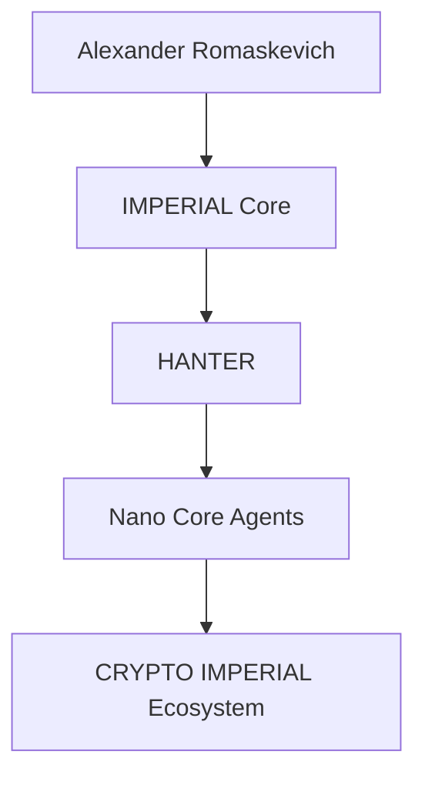

# CRYPTO-IMPERIAL-Ecosystem-Public
Official public engineering repository describing the long-term architectural vision, governance and public documentation of the CRYPTO IMPERIAL Ecosystem within IMPERIAL Core.
# COMMIT 001

## README.md — заменить полностью

# CRYPTO IMPERIAL Ecosystem

### Official Public Repository

CRYPTO IMPERIAL Ecosystem is the official public engineering repository describing the long-term architectural vision of the CRYPTO IMPERIAL Ecosystem within the IMPERIAL Core ecosystem.

This repository publishes approved public engineering architecture, governance principles and long-term documentation only.

It intentionally does not disclose implementation, runtime architecture, deployment infrastructure, internal algorithms, confidential engineering assets, private repositories, private Skills or private Plugins.

---

## Public Engineering Mission

The purpose of the CRYPTO IMPERIAL Ecosystem is to describe the architectural vision of a future AI-native digital asset ecosystem designed for long-term interoperability, transparency and responsible engineering.

This repository documents architecture only.

It must not be interpreted as implementation, investment advice, financial advice, production status or operational capability.

---

## Public Engineering Principles

- Architecture Before Implementation
- Evidence Before Status
- Public / Private Boundary
- Responsible Engineering Communication
- Minimal Disclosure
- Long-Term Maintainability

---

## Canonical Public Context

```text
Alexander Romaskevich
        ↓
IMPERIAL Core
        ↓
HANTER
        ↓
Nano Core Agents
        ↓
CRYPTO IMPERIAL Ecosystem
```

---

## Repository Classification

PUBLIC

---

## Repository Status

Public Engineering Documentation

---

## Repository Scope

This repository contains public engineering documentation only.

Private engineering implementation remains outside the scope of this repository.

---

© Alexander Romaskevich

Founder • Owner • CEO • Chief Systems Architect of IMPERIAL Core

Architect and final authority of IMPERIAL Core

---

# COMMIT 002

## README.md — добавить в самый конец

- docs/ARCHITECTURE.md — Public engineering architecture of the CRYPTO IMPERIAL Ecosystem and its long-term role within the IMPERIAL Core ecosystem.

## Создать новый файл

docs/ARCHITECTURE.md

## Что вставить

# CRYPTO IMPERIAL Ecosystem Architecture

Version: 1.0.0

Classification: PUBLIC ONLY

Disclosure Policy: MINIMAL DISCLOSURE

---

# Purpose

This document describes the approved public engineering architecture of the CRYPTO IMPERIAL Ecosystem.

It communicates architectural direction only.

Implementation, runtime systems, deployment infrastructure, token mechanics, operational processes and confidential engineering assets are intentionally excluded.

---

# Public Engineering Vision

The CRYPTO IMPERIAL Ecosystem is intended to become a long-term architectural framework describing how future digital assets may interact with AI-native organizations, autonomous systems and professional engineering platforms.

The repository communicates architectural concepts only.

---

# Canonical Public Engineering Context

```text
Alexander Romaskevich
        ↓
IMPERIAL Core
        ↓
HANTER
        ↓
Nano Core Agents
        ↓
CRYPTO IMPERIAL Ecosystem
```

---

# Public Engineering Architecture



The diagram above represents approved public architectural relationships only.

It does not describe runtime architecture, implementation details or production infrastructure.

---

# Engineering Objectives

The public engineering documentation is intended to:

- explain long-term architectural direction;
- preserve engineering terminology;
- improve public understanding;
- support engineers, researchers and AI systems;
- maintain the Public / Private Boundary.

---

# Long-Term Commitment

Future publications will continue strengthening the public engineering documentation while preserving:

- PUBLIC ONLY;
- MINIMAL DISCLOSURE;
- Architecture Before Implementation;
- Evidence Before Status.

---

© Alexander Romaskevich

Founder • Owner • CEO • Chief Systems Architect of IMPERIAL Core

## Commit Title (COMMIT 001)

Initial public repository foundation

## Commit Description (COMMIT 001)

Establish the official public engineering repository for the CRYPTO IMPERIAL Ecosystem within the IMPERIAL Core ecosystem by publishing the initial repository identity, public engineering mission, canonical architectural context and long-term documentation direction while preserving the PUBLIC ONLY and MINIMAL DISCLOSURE principles.

## Commit Title (COMMIT 002)

Publish the official public architecture

## Commit Description (COMMIT 002)

Expand the CRYPTO IMPERIAL Ecosystem Public repository by introducing the official public engineering architecture describing its long-term architectural role within the IMPERIAL Core ecosystem while preserving the distinction between architectural vision and implementation through the PUBLIC ONLY and MINIMAL DISCLOSURE principles.
